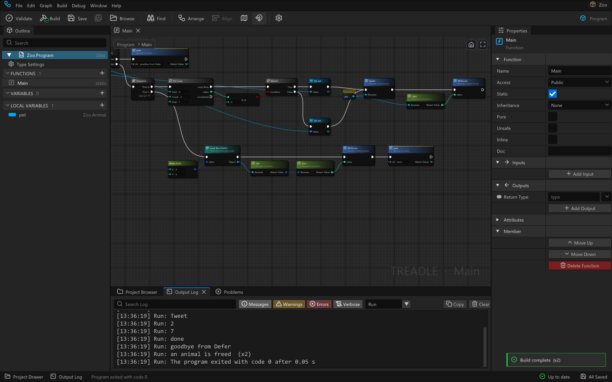

# Treadle

Treadle is a visual programming language with its own IDE. There is no text source behind the graphs: the node
graphs are the program. Treadle compiles them through LLVM to native code that runs at about the speed of C, with
no garbage collector and no interpreter. The semantics are close to the Beef language: classes and structs,
generics, and memory you control. If you have built logic in a game engine's node-graph scripting editor, or
written C#, C++ or Beef, and you want native speed without a GC, Treadle is for you. It runs on Windows and
Linux.

## What works today

This is the first alpha. Everything below works on Windows; [docs/Linux.md](docs/Linux.md) lists the few
places where Linux differs.

* **Projects**: console programs, windowed programs (the repository's samples include an SDL Breakout game)
  and libraries (a DLL, or a `.so` on Linux, with C-callable exports). Debug, Release and your own build
  configs.
* **Types**: classes with one base class, virtual functions and destructors; structs; interfaces; enums,
  including enums whose cases carry values; tuples; generics with constraints, each type argument compiled to
  its own copy; extensions that add members to any type; delegates, events and Lambdas with captures.
* **Memory without a GC**: **Construct** makes an object you delete, **Local** makes one that its region
  frees, and **Defer** / **Defer Delete** run when control leaves a region. Debug builds name the node behind
  every leak, double Delete, use after Delete, null member access and index out of range.

  

* **Errors as values**: `Result<T, E>` and `Option<T>`, with **Try**, **Result: match** and **Unwrap**. There
  are no exceptions.
* **Core library**, written in Treadle itself: String and StringView (UTF-8), List, Dictionary, HashSet,
  Queue, Stack, Span, File, Directory, Path, Math, Random, Console, Time, Stopwatch, Environment, Process,
  Option and Result; threads (Thread, Mutex, Condition, ThreadPool, Parallel For); and a math library (Vec2,
  Vec3, Vec4 and their double forms, Mat3, Mat4, Quat, Color, Rect, AABB, Plane, Ray, Transform).
* **SIMD vectors** as plain types (`float4`, `int32x4`, `double2` ...): element-wise operators, swizzles and
  lane functions that compile to SSE / AVX instructions.
* **C interop**: name a few headers in a `.cimport` set, and libclang (shipped) turns their functions,
  structs, enums, constants and variables into nodes. You write no wrapper code.
* **Graph debugger** over lldb-dap: breakpoints on nodes, stepping node by node, values on the pins, Locals
  and Call Stack, fatal errors that open the Sheet on the failing node, and attaching to a running Debug
  build. On Windows a build can also write a PDB for other debuggers.
* **Editor**: Sheets with an Outline, Properties, a searchable Node menu, Project Browser, Problems and Output
  Log; Arrange, node groups, split struct pins, Extract to Function, undo, and crash recovery.
* **Packages**: one Windows zip and one Linux tarball, each with its own compiler, linker, debugger and C
  import. Nothing else to install on Windows.
* **Speed**: on nine benchmark kernels, Release builds run as fast as the same program in C or within about
  20% of it. See [docs/Performance.md](docs/Performance.md).

## Install

Download the package for your system from the
[Releases page](https://github.com/AproposRobin/Treadle/releases).

* **Windows 10 or 11 (64-bit)**: unzip `Treadle-<version>-win64.zip` into a folder you can write to and run
  `Treadle.exe`. The programs it builds need only the DLLs that come with Windows.
* **Linux (x86-64, glibc 2.43 or newer, for example Ubuntu 26.04)**: run `sudo apt install libc6-dev`, unpack
  `Treadle-<version>-linux-x64.tar.gz` and run `./treadle`. The editor needs a desktop session (X11, or
  Wayland with XWayland). [docs/Linux.md](docs/Linux.md) has the details.

Keep the folder together: the editor finds its toolchain next to itself. To remove Treadle, delete the folder
and its settings folder (`%LOCALAPPDATA%\Treadle`, or `~/.local/share/Treadle` on Linux). Treadle sends
nothing over the network: no telemetry and no update checks.

## Your first hour

[docs/Getting-Started.md](docs/Getting-Started.md) walks you through making a project and building a small
program: a class hierarchy, a struct, a generic type, memory, a loop and a call to a C function. Then you run
the program and step through it in the debugger. The same page is in the editor under **Help**.

## Docs

These pages ship in every package and appear in the editor's Help:

| Page | What it covers |
|---|---|
| [Getting started](docs/Getting-Started.md) | Install, your first project, run and debug |
| [Language guide](docs/Language-Guide.md) | Types, memory, control flow, errors, functions, Lambdas, projects, glossary |
| [Core library](docs/Core-Library.md) | Who owns what, the API by type, formats, UTF-8, what is not there yet |
| [C header import](docs/C-Import.md) | `.cimport` sets, what each C declaration becomes, linking |
| [Debugging](docs/Debugging.md) | Breakpoints, steps, pin values, attach, other debuggers |
| [Keyboard and mouse](docs/Keyboard.md) | Every shortcut and mouse gesture |
| [Linux](docs/Linux.md) | What your system needs and what differs from Windows |
| [Performance](docs/Performance.md) | The benchmark kernels against C, Debug against Release |
| [Known issues](docs/Known-Issues.md) | The alpha's limits and what to do instead today |

The notes for this release are in [docs/Release-Notes-0.1.3-alpha.md](docs/Release-Notes-0.1.3-alpha.md) (earlier: [0.1.2-alpha](docs/Release-Notes-0.1.2-alpha.md), [0.1.1-alpha](docs/Release-Notes-0.1.1-alpha.md), [0.1.0-alpha](docs/Release-Notes-0.1.0-alpha.md)).

## Status

Treadle is an **alpha** for testing. The language, the editor and the file format work end to end, but expect
rough edges. [docs/Known-Issues.md](docs/Known-Issues.md) lists what is missing today and what to do instead.

The graph files are your program, so keep them in version control: they are line-based text and diff well.
The file format is not frozen before the beta. When it changes, `Treadle --format --migrate <project folder>`
brings a whole project forward, and a backup is written beside each file before it is first saved.

## Report a problem

In the editor, use **Help > Report a Problem**. It builds a bundle on your computer, shows you every file in
it, and opens a pre-filled issue at <https://github.com/AproposRobin/Treadle/issues>. Nothing is uploaded for
you. If the editor does not start, open an issue there with the version line (run the editor with
`--version`) and the newest crash log; [docs/Known-Issues.md](docs/Known-Issues.md) says where the crash logs
are kept.

## Build from source

Treadle's editor is written in Beef. [docs/Building.md](docs/Building.md) has the pinned tools, the build
commands for Windows and Linux, and the package scripts.

## License and attribution

Treadle is licensed under the [Apache License, Version 2.0](LICENSE). Its editor shell, native host and
graph-editing model are derived from VisualBeef, a node editor by the same author (Apache-2.0, see
[NOTICE](NOTICE)). The packages bundle LLVM, lldb, libclang, Dear ImGui, SDL2, the Beef runtime and other
components under their own permissive licences: [THIRD_PARTY.md](THIRD_PARTY.md) lists them, and their
licence texts are in `THIRD_PARTY/`.
