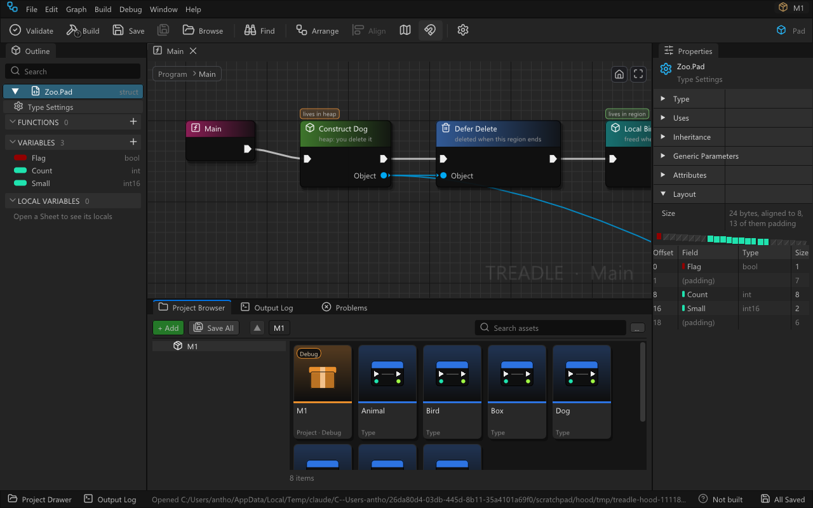
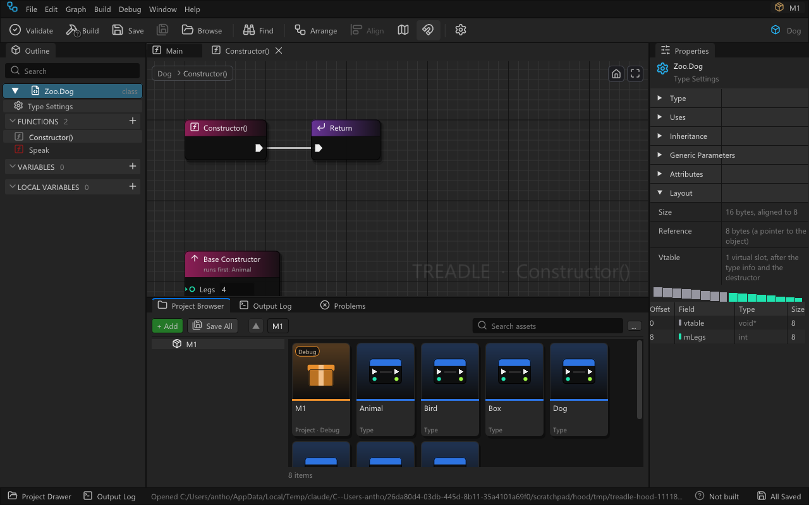
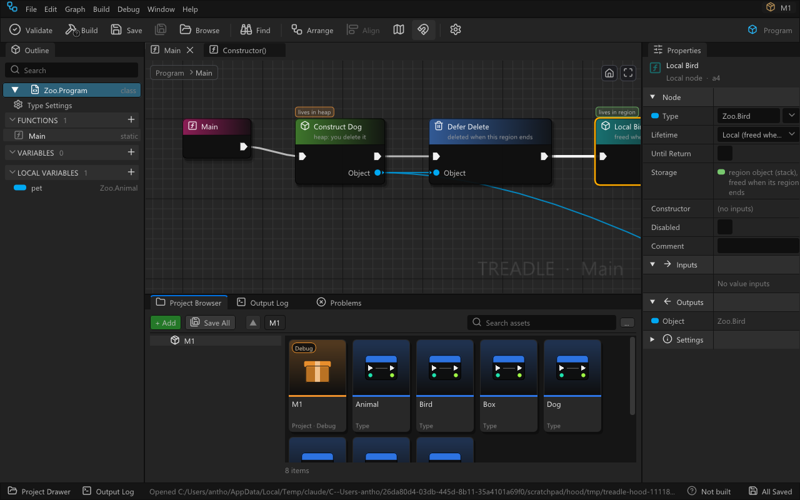
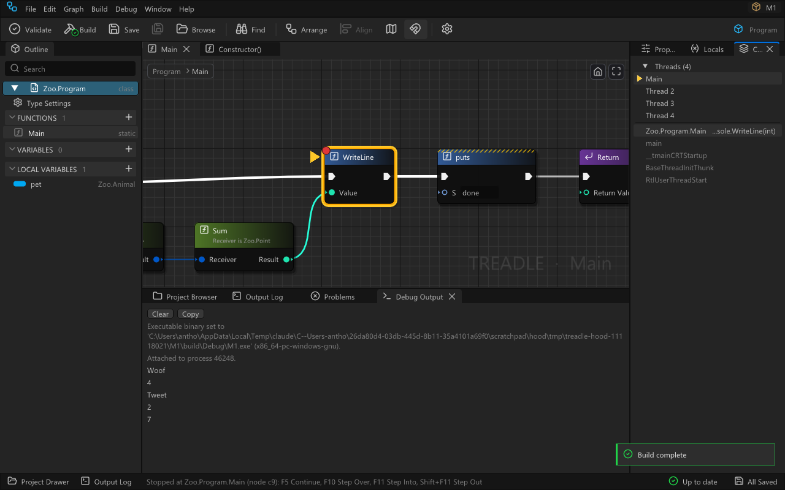
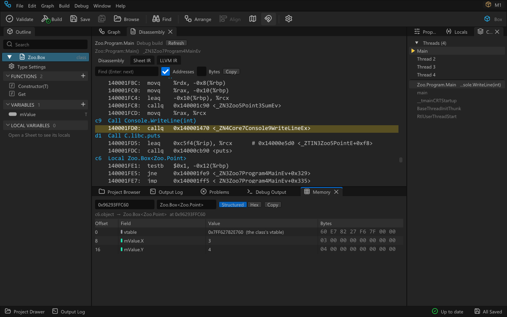
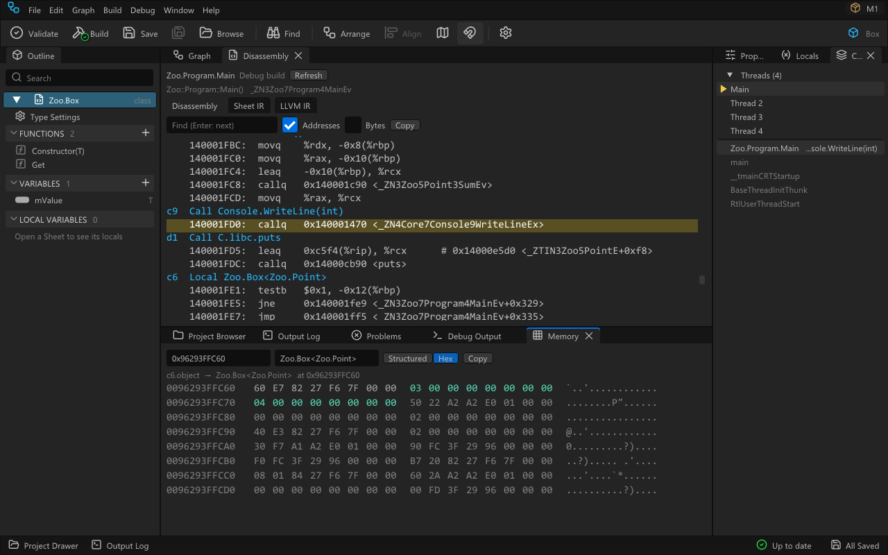
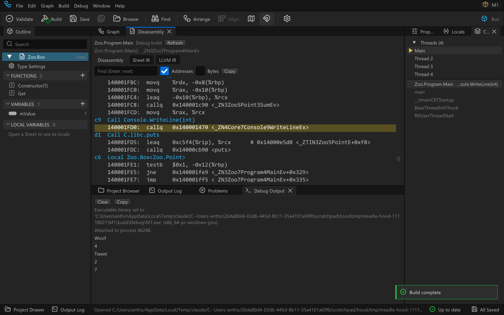
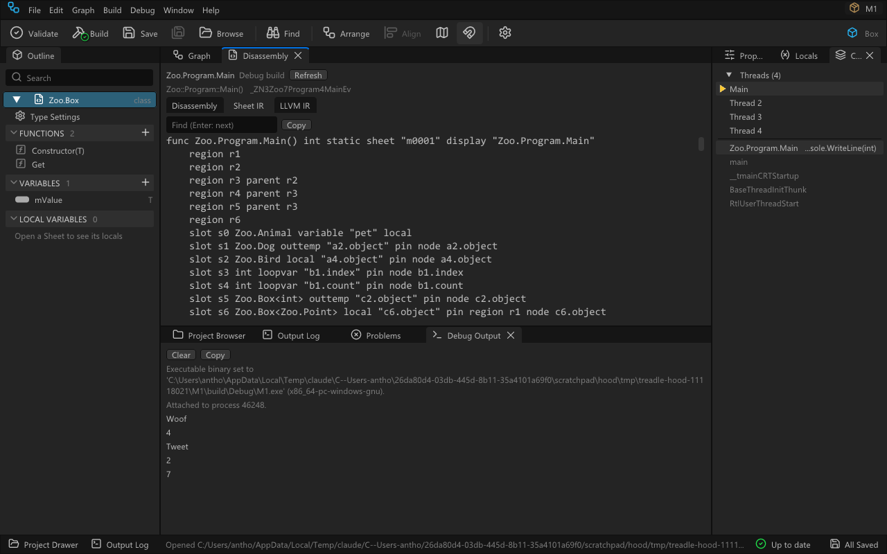

# Debugging

Treadle programs are debugged on their graphs: a breakpoint goes on a node, the program stops on a node,
the steps go from node to node, and the values sit on the pins. Underneath it is an ordinary native
debugger (lldb, shipped with Treadle). This page is how to use it and what it does not do yet.

## Using it

| Keys | Command | What it does |
|---|---|---|
| **F5** | Start Debugging / Continue | Not debugging: saves, builds the project in **Debug** (whatever configuration is active) through the toolchain, runs the exe under the debugger. Stopped: continue. |
| **Shift+F5** | Stop Debugging | Ends the program. |
| Debug menu | Pause | Stops a running program; the thread that is in project code is shown. |
| Debug menu | Attach to Process... | Lists the project's Debug builds that are running (`build/Debug/<Name>.exe` started outside the editor, by process id) and, for a library project, the programs that loaded its `build/Debug` library (marked `(loaded <Name>.dll)`), and debugs the one picked: its breakpoints are set, it runs on and stops on them like a launched program. Stop Debugging detaches and leaves it running. |
| **F9** | Toggle Breakpoint | On the selected flow node(s); also a click on the circle at a node's top-left corner. |
| **F10** | Step Over | Runs the node and stops on the next flow node of the Sheet. |
| **F11** | Step Into | Goes into the function the node calls (also the calls of the value nodes it reads) when it is project code; anything else (the runtime, the C library, the core library) is stepped over. |
| **Shift+F11** | Step Out | Runs to the end of the function; stops on the calling node. |
| Debug menu | Remove All Breakpoints | For the open project. |
| Debug menu | Disassembly | The machine code of the function of the selected frame (or of the Sheet in front) from the last build ([Disassembly](#disassembly)). |
| Debug menu | Memory | Shows or hides the Memory panel ([Memory](#memory)). |

* **Breakpoints**: a red dot on the node's top-left corner. Only flow nodes take one: a value node's code
  runs inside the flow node that reads it, so the breakpoint goes there. They are kept per project in
  `%LOCALAPPDATA%\Treadle\settings.json`, `projects.<folder>.breakpoints`, as `{file, sheet, node}` with the
  file relative to the project folder, never in the type files.
* **The stop**: the Sheet opens on the node (the type's file is opened when needed, so a stop in another
  type shows that type's Sheet), the node is selected, scrolled into view, outlined in yellow with an arrow
  on its left. The status bar says where (`Stopped at Zoo.Program.Main (node b7)`).
* **Values on pins**: each value pin of the stopped node with a known value gets a small bubble beside it
  (a class reference shows the object's own type, `Zoo.Dog`); hovering any value pin of the frame's Sheet
  shows `Value: ...` or why there is none.
* **Locals** (docked with Properties, in front at a session's first stop): `this`, the parameters, the
  function's locals, then **Pin values** (the flow nodes' outputs, `<node>.<pin>`), with value and type;
  each value is summarised by its type (the table under "Variables" below), objects and structs expand member
  by member, Lists, Dictionaries and arrays element by element. The box at the top evaluates a pin
  (`a2.object`), a local (`pet`), a member path (`pet.mLegs`) or an expression lldb reads.
* **Call Stack**: one row per frame; project frames read `Zoo.Program.Main   b7  Call Zoo.Animal.Speak()`,
  other frames are dimmed. A row wider than the panel is cut in the middle (`Cx.ThreadsBas...l Thread.Join`); its
  tooltip has it whole. A click selects the frame (Locals and the pin values follow) and opens its node.
* **Threads**: a program with more than one thread lists them at the top of Call Stack, `Main` first, then by name (the
  name a Thread was made with, `Pool 1` for the thread pool; `worker 2` before `worker 10`), then `Thread <n>` for the
  ones without a name; the current thread is selected and marked with the stop arrow. A click on another thread shows its call stack (and its Locals) without running the program, and opens its
  node. A breakpoint hit on any thread stops the whole program there; Continue runs all threads, and the steps step
  the selected thread while the others run on.
* **Debug Output** (docked with the Output Log): what the program writes (stdout and stderr), and dimmed,
  the debugger's own lines (launch, exit code, a fatal stop). Clear and Copy.

## What stops and values mean

* **Breakpoints** go on flow nodes only: a value node's code runs inside the flow node that reads it. A node
  with no code in the last build (edited since, or compiled to nothing) is skipped with a line in Debug Output.
  Breakpoints set while running take effect at once.
* **Value nodes** run for the flow node that reads them. A stop may therefore be shown on that flow node before
  its inputs have all been evaluated: a stop "on b9" may come before b9's `Legs()` input was called, and Step Into
  from there goes into Legs.
* **Steps** follow the nodes: Step Over and Step Into continue until the program is on another node of the
  Sheet; code outside the project (the runtime, the C library, the core library) is stepped over; when Main has
  returned, the program runs to its end. A loop's increment and test stop on the loop node, Step Into a function
  stops on its Entry node, a Return has its own stop, and leaving a region stops on each Defer and on each Local
  whose destructor runs.
* **Call Stack** rows read `Zoo.Program.Main   b7  Call Zoo.Animal.Speak()`: the Sheet, the node id and its title.
* **Locals** show `this`, the parameters, the function's local variables by their Sheet names (`pet`), and each
  flow node's output as `<node>.<pin>` (`a2.object`). A reference shows the referenced type itself
  (`Zoo.Animal`, `Core.List<Core.String>`). The same text appears in Locals, Evaluate and the pin bubbles (a
  bubble drops an object's address and cuts the text at 40 characters):

  | Type | Shows | Expands to |
  |---|---|---|
  | basic types | the value (`5`, `true`, `'A'`, `2.25`; a `uint8` / `int8` as a number, `255`, not lldb's `'\xff'`) | |
  | vector | its type and lanes, `float4(1, 2, 3, 4)` (the first 6 lanes, then `...`); the type reads `float4`, `int32x4` rather than lldb's `float __attribute__((ext_vector_type(4)))` | the lanes `[0]`, `[1]`, ... |
  | `Vec2` ... `Vec4d`, `Quat`, `Color`, `Color32`, `Rect`, `RectI` | the type and its fields, `Vec3(1, 2.25, -0.5)`, `Color32(255, 128, 0, 255)` | its fields |
  | simple enum | the case name (`Green`) | |
  | `String` | its text, quoted (`"13 words, 10 different"`, the first 200 bytes) | its fields |
  | `StringView` | its text, quoted | `Ptr`, `Length` |
  | `List<T>` | `["the", "fox", ...] (10)`: the first 8 elements and the count | the elements `[0]`, `[1]`, ... (up to 500) |
  | `Dictionary<K,V>` | `{"the": 3, "lazy": 1, ...} (10)`: the first 8 entries in slot order and the count | one row per entry, `["the"]` = `3` |
  | `T[]` | `[10, 20, 30] (3)` | the elements |
  | `Option`, `Result`, any payload enum | `Some(5)`, `None`, `Ok(x)`, `Err(7)`, `Rect(4, 6)` | `tag`, `payload` (a union of the cases) |
  | `T?` | the value, or `null` | `hasValue`, `value` |
  | tuple | `(3, true)` | `item0`, `item1`, ... |
  | delegate | the function bound: `Zoo.Program.Twice`, `Lambda c2` | `vtable`, `target`, `fn` |
  | object | its own type and address (`Zoo.Dog (0x1A4ED746D60)`); `null`; a deleted object `<deleted object> (0x..)`; a Local not constructed yet says so | its fields |
  | struct | its first members, each summarised (`{Value = 11, Ok = true}`) | its fields |

* **Pin values on the canvas** come from the selected frame: a flow node's output pin is its `<node>.<pin>`
  value; an input pin takes the value of the pin wired to it; a Get of a local or parameter is that variable; an
  unwired Receiver is `this`. Other value nodes keep no value ("shown only by running code").

## Under the hood

A graph hides the machine, but nothing about it is secret. Five views show what the compiler made of a type
or a Sheet and what the running program holds: **Layout** and **Lives in** work without a build, the
**Disassembly** needs one, **Call Stack** and **Memory** need a stopped program. All of them are read-only.

### Layout

**Type Settings > Layout** (the type header in the Outline, then the Layout section at the bottom of
Properties) shows where each field of a class, struct or enum sits in memory, computed by the compiler's own
layout rules, so the numbers are the ones the build uses. No build or run is needed; unsaved edits count.



* **Size**: the bytes one value takes, padding included, and its alignment (an array or a field of the type
  repeats both). The total padding is named.
* **The bar**: one cell per byte, each field in the colour its pins have, padding hatched in grey. A thin gap
  marks where a field ends. Hover a cell for the field.
* **The table**: offset, field, type, size (and alignment when the panel is wide; otherwise in the tooltip).
  Padding rows are muted: those bytes are unused so that the next field starts aligned. Hover a row for the byte
  range and, for a class, the base class that declares the field.
* **A class** starts with the **vtable pointer** (8 bytes at offset 0), then the base classes' fields, then its
  own. Its Size is one object; a variable, field or pin of the class holds an 8-byte reference to it (the
  **Reference** row). **Vtable** counts its virtual slots.
* **A payload enum** has a **tag** (which case it holds, 4 bytes at 0) and a **payload** area shared by the
  cases; each case's fields follow, indented, at their offsets. A simple enum is its tag type.
* **A generic type** has no layout of its own: type an instantiation (`Zoo.Box<int>`, `Zoo.Box<Zoo.Point>`) in
  the **Instantiation** row.



### Lives in

Every Construct and Local node carries a small badge above its header saying where the object it makes lives
(a Bind or Lambda that allocates its delegate too), and Properties has a **Storage** row with a one-line
explanation; the Outline's variables say it in their tooltip, and a field's or a local variable's page in
Properties has the same Storage row. The places are those of [Language.md](Language.md), "Where values live":

| Shown as | Where | Freed |
|---|---|---|
| `lives in heap` | Construct: heap memory | by a Delete (or an owner's destructor); otherwise a leak the Debug build reports |
| `lives in region` | Local: stack memory of the part of the Sheet the node is in | when control leaves that part (each pass of a loop body) |
| `lives in frame` | Local with Until Return; local variables and parameters (Properties, Outline) | when the function returns |
| `static` | static fields and constants (Properties, Outline) | never: one copy for the program |
| `inline` | a struct's fields, an appended object (Properties, Outline) | with the value they are inside |



A variable of a class type is a reference: its Storage reads `frame slot holding a reference`, and the object
lives where it was made.

### Call Stack

One row per frame: the Sheet and the node the frame is at (`Zoo.Program.Main   c9  Call Console.WriteLine(int)`,
through the build's `.nodemap`), frames outside the project dimmed. A click selects the frame: Locals, the pin
values on the canvas and the Disassembly's marked instruction follow it, and its node is shown. With several
threads, their rows come first (see Threads above). Right-click a frame: **Show Frame in Memory** (the frame's
stack bytes) and **Disassembly** (its function).



### Memory

The bytes behind a value while the program is stopped. Open it from a row of **Locals** (right-click > **Show in
Memory**: a local, a parameter, `this` or a pin value such as `c6.object`), from a frame of **Call Stack**
(right-click > **Show Frame in Memory**), from **Debug > Memory** or **Window > Memory**; or type any address
(`0x...`) into its address box. Bottom dock, next to Debug Output.

* **Structured** lays the type's fields over the bytes: offset, field (struct fields down to their basic values,
  `mValue.X`), the decoded value, the raw bytes. Padding rows are muted. The type comes from the variable, and
  the **as type** box reads the bytes as any other type.
* **A reference is followed**: a class variable or pin holds an address; Memory shows the object it references
  (the header line says `c6.object  ->  Zoo.Box<Zoo.Point>  at 0x...`, its tooltip where the reference was read).
  A pointer field or reference field has a **Follow** button; **Back** returns.
* **Hex** shows 16 bytes per row: the address, the bytes (coloured by field when the type is known) and the
  characters. **Copy** puts the hex text on the clipboard.
* **Show Frame in Memory** reads from the frame's stack pointer to just above its frame pointer: the frame's
  slots, the caller's saved frame pointer and the return address.
* It reads again at every stop and step. Memory that cannot be read (address 0, an address the program has not
  mapped, a variable kept in a register) says so; nothing is written.





### Disassembly

The machine code a function was built into, grouped under the node each instruction was made for (the line
table points at the unit's listing, whose lines are nodes). Open it from a function's right-click menu in the
Outline (**Disassembly**), from **Debug > Disassembly** (the function of the selected frame, else the Sheet in
front), from a Call Stack frame, or **Window > Disassembly**. It opens as a tab next to the graph.

* It reads the **last build of the active configuration** (`build/<Config>`): build first (F7). The function
  is found by its Sheet, so a generic type's function lists every instantiation built (a list at the top picks
  one); a Sheet nothing calls was not built.
* Each **node heading** (`b7  Call Zoo.Animal.Speak()`) is followed by its instructions; a node can appear more
  than once (a loop's test after its body, a Defer at the region's end). A click on a heading shows the node.
  Code before the first node is the function's set-up.
* **Addresses** and **Bytes** (the encoding) are toggles. **Find** highlights matches; Enter goes to the next.
  **Copy** puts the tab's text on the clipboard.
* **While stopped**, the instruction the selected frame is on is marked in yellow.
* **Sheet IR** is the function in the Sheet IR (`.tir`, Compiler.md 4) as Build lowers the saved files;
  **LLVM IR** is its `define` from the unit's `.ll`.
* **Release**: the Release exe carries no symbols, so the listing comes from the unit's `.ll` compiled again
  on its own with the build's flags (into `build/Release/disasm/`); a note says so. The code is the same except
  where the link inlined calls between types. Instructions inlined from another type are grouped under that
  type's node, marked `(inlined from <Type>)`.





## Windowed programs

A project of kind `windowed` is debugged like a console program: F5 builds it in Debug and starts it under
the debugger, breakpoints, steps, Locals and the pin bubbles work the same, and Stop Debugging ends it (its
window closes). What it writes (Console nodes, and C functions such as `puts`) appears in **Debug Output**
as it is written, so a stop shows everything the program wrote before it.

Started outside the editor, its output goes:

* to the window of a command prompt (cmd, PowerShell, Windows Terminal) it was started from, or to a file or
  pipe the command line redirected it to (`MyGame.exe > log.txt`);
* nowhere visible when it is started by a double-click or by a program that gives it no output: the text
  goes to the Windows debug output instead, which a debugger shows and which DebugView (Sysinternals) shows
  without one. The program runs normally either way.

## Libraries

A project of kind `library` builds `build/Debug/<Name>.dll`, which another program (the host) loads. F5
has nothing to run; debug it by attaching to the host:

1. Build the project in Debug (F7, Debug configuration) and start the host so that it loads
   `build/Debug/<Name>.dll` (that exact file, not a copy elsewhere).
2. Set breakpoints on the library's Sheets (an exported function's Sheet, or anything it calls).
3. **Debug > Attach to Process...** lists the host as `host.exe   process 1234   (loaded <Name>.dll)`; pick it.
4. When the host calls into the library, it stops on the node. Locals, pin values and the steps work as in a
   program; the call stack shows the library's Sheets above the host's own frames (dimmed). Stop Debugging
   detaches and leaves the host running.

On Linux the library is `build/Debug/lib<Name>.so`, and Attach to Process finds the hosts that mapped it by reading
`/proc/<pid>/maps`. Yama's `ptrace_scope` 1 (the Ubuntu default) lets only a process's ancestors attach, and the
editor's lldb-dap is not the host's ancestor: a Debug library's `treadle_init` therefore allows any debugger of the
same user to attach to its host (`PR_SET_PTRACER_ANY`, what a Debug program does at its start; a Release library
leaves the host alone). The `debug` self test runs the whole sequence on Linux too (a C host that `dlopen`s the
library, Attach, the stop on `a3` of `Lib.Mathx.Twice` with `x = 21` in Locals, the host's `main` below it).

## Fatal runtime errors

In a Debug build the runtime checks double frees, deletes of a foreign pointer, uses of a deleted object, null
references and array bounds, and runs Fatal nodes: it prints `fatal: <message> at <Type.Function> node <id>`,
followed by ` on thread "<name>"` when the error is on a thread other than the main one,
runs the leak report and exits with code 3. Under the debugger it stops first, as a **Fatal** stop: the first
project frame is selected, which is the node that called into the runtime (the Delete node for a double free),
and the message is a toast, a dimmed Debug Output line and the status bar. Continue lets the program exit (code
3); Stop ends it. Other exceptions (an access violation) stop the same way with the debugger's description.

A Release build has none of these checks; it reports what the C heap and the processor catch on their own (a
double free the heap notices, an access that faults) as `fatal: ...` with exit code 3 and no node, at no cost per
allocation.

## Using other debuggers

The editor's debugger reads DWARF. Tools that read only PDBs (Visual Studio, WinDbg, RenderDoc's or a
profiler's symbol lookup, crash dump tools) need CodeView, which a project config asks for in the
`.tproj` file (Windows):

```
config Debug
	checks on
	debugFormat both
	optimize 0
```

| `debugFormat` | The exe | Next to the exe | The editor's debugger |
|---|---|---|---|
| `dwarf` (default, also when not set) | DWARF | nothing | full: every check on this page |
| `both` | DWARF and the COFF symbol table | `<Name>.pdb` (CodeView) | full, unchanged (lldb reads the DWARF) |
| `codeview` | the COFF symbol table, mingw's CRT DWARF only | `<Name>.pdb` | works: the adapter hands lldb-dap the PDB (`target symbols add`, `preRunCommands`) because lldb would otherwise take the CRT's DWARF; breakpoints, stops and steps by node work, but typedef names are lost (`long long` instead of `int`) and register-held values read "not available" |

Pick `both` for a project that is debugged in the editor and also opened in a PDB tool. The PDB's
line table points at the listing files (`build/Debug/<Unit>.lst`, one line per node, the absolute path of
the build folder; `llvm-pdbutil dump -l <Name>.pdb`), so a PDB debugger shows the node's listing line as
the "source": open the `.lst` next to the graph, or set a breakpoint by file and line from the
`.nodemap` (`<sheetKey> <nodeId> <line>`). Locals carry the same names (`pet`, `a2.object`). A
`codeview` / `both` build also writes the runtime with CodeView, so its functions resolve too. In Release
the PDB holds line tables only (the exe stays stripped). On Linux the setting is ignored (the build writes
DWARF and says so in the Output Log). Each link writes `build/<Config>/debug-format.txt` (`dwarf`,
`codeview` or `both`), which is how the adapter knows to add the PDB.

## Limits

* Attach lists only the project's own Debug builds (an executable directly in `build/Debug`, or a program that
  loaded the library directly from `build/Debug`), so a program built before the last edit stops on the nodes
  of that build. An attached program's output is not captured: it goes where the program writes it. Stop Debugging detaches. On Linux, attaching needs
  Yama's `ptrace_scope` 0 or 1 (1 is the Ubuntu default); 2 or 3 refuses it.
* Windows and Linux ([Linux.md](Linux.md), "What is different from Windows").
* `this` and the parameters stay in Locals for the whole function in Debug.
* A summary reads at most 8 elements or entries, 200 bytes of text, two levels deep; an expanded container
  lists at most 500. A Dictionary's entries are in slot order (the hash order), not insertion order.
* Elements of a struct, enum, tuple or nullable type inside a container read from a pin (not a variable) show
  `{...}`.
* Value nodes keep no value; their pins show a value only when it comes from a variable or a flow node's output.
* Editing a Sheet while stopped is allowed; the running program is the one that was built, so lines and nodes
  may not match until the next F5.
* Memory reads, it never writes. Show in Memory works on the top-level rows of Locals (a member's bytes are inside
  its owner's: show the owner, or Follow a reference field). A struct larger than 4 KiB shows its first 4 KiB.
* The Disassembly is of the last build, not of the edits since; its Sheet IR is lowered from the saved files.
  The marked instruction needs a Debug build of the exe (Release listings are compiled again, at other addresses).
