# Getting started

Treadle is a visual programming language. A program is a set of node graphs, one file per type, and Treadle
compiles them to a native Windows program. There is no text source behind the graphs: the graph is the program.

If you have built logic in a node-graph scripting editor before, most of this page will feel familiar: flow
wires carry the order things run in, value nodes compute, each function has an Entry node and Return nodes,
and the Node menu places nodes. [What is different](#what-is-different) lists what works another way.

In this hour you build a small program called Zoo: an Animal class with a Dog and a Bird, a Point struct, a
generic Box, and a Main that allocates them, loops over them and prints through a C function. Then you run it
and step through it in the debugger.

## Install

1. Unzip `Treadle-<version>-win64.zip` into a folder you can write to, for example `C:\Users\<you>\Treadle`.
   Keep the folder together: the editor finds its compiler, core library and C import next to itself.
2. Run `Treadle.exe`.

Windows 10 or 11 (64-bit) is needed. The programs Treadle builds use only DLLs that come with Windows, so they
run on any Windows 10 or 11 computer. To remove Treadle, delete its folder and `%LOCALAPPDATA%\Treadle`
(settings, logs and the build cache).

## Your first program

Five steps from nothing to a line printed by your own program:

1. **File > New Project...** (or **New project...** on the start page): type a name, choose a Location,
   **Create**.
2. **Main is your start.** The project opens on `Program.Main`, with a comment *Your program starts here*
   above its Entry node. The status bar says **Entry: Program.Main** (click it to come back here) and the
   Outline marks Main with a play glyph.
3. **Place a WriteLine.** Drag a wire from the Entry node's white arrow into empty space, type `writeline
   string`, press **Enter**, and type `Hello` into the new node's box.
4. **Run** (Ctrl+F5, the green play button on the toolbar). Run does the build for you; Build alone (F7) is for
   checking errors or shipping.
5. **The output** shows in the Output Log at the bottom, under Run: `Hello`.

To call a function of another type, say `Run` of a class `Engine`, type `engine run` in the Node menu. A function
that works on an Engine needs one: pick **Construct Engine + Run**, which places a Construct Engine, a Defer
Delete and the Run call wired together, or place **Run** and drag from its **Receiver** to a **Local Engine**
(the simple choice: the Engine lives until Main ends) or a variable. Construct with a Delete is for an object that
must outlive the region it is made in. A **static** function needs no object and places with no Receiver.

Another static `Main` can be the start: right-click it in the Outline, **Set as entry point** (Ctrl+Z undoes it).
A project with no entry point fails to build with **Create Main** offered in Problems (also in the Build menu).

## Make a project

**File > New Project...** (or **New project...** on the start page). Type the name `Zoo`, choose a Location
that exists, and click **Create**.

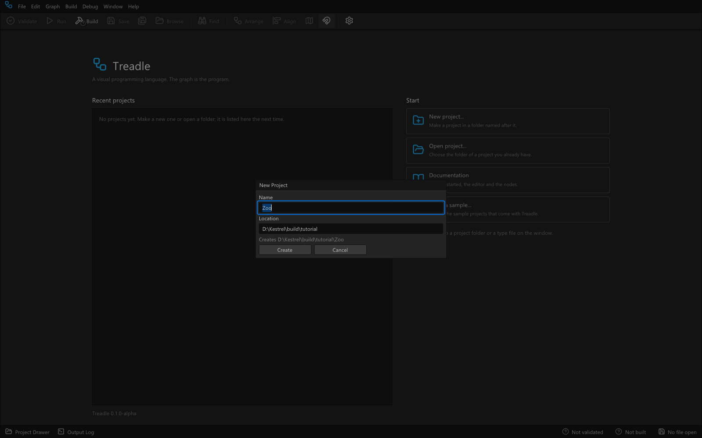

Treadle makes the folder `Zoo` with the project file `Zoo.tproj` and a `Source` folder holding one type,
`Program`, whose function `Main` runs when the program starts. The project opens with `Main` in front.
As you work, Treadle may add two more folders: `layout`, which holds each type's node positions (so the type files stay clean and a graph runs without them), and `backup`, which holds the previous version of each file you save over. New Project also writes a `.gitignore` that ignores `backup/`; keep `layout/` in version control if you want to share positions.

## The window

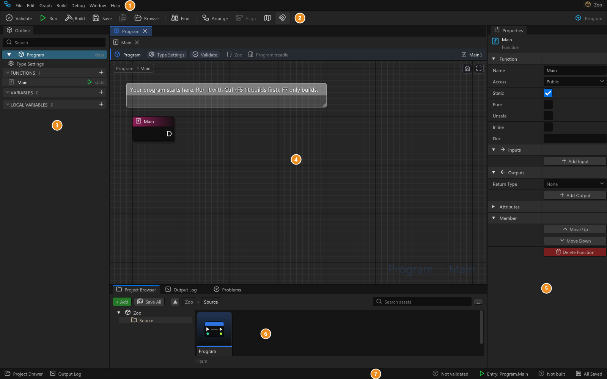

1. **Menu bar**: File, Edit, Graph, Build, Debug, Window, Help. The project's name is at the right.
2. **Toolbar**: Validate, **Run** (builds when needed, then starts the program), Build, Save, Browse, Find,
   **Arrange** (tidies the Sheet in front), Align.
3. **Outline**: the type in front. **Type Settings** (name, kind, namespace, base type, generic parameters), then
   **FUNCTIONS**, **VARIABLES** (the type's fields) and **LOCAL VARIABLES** (of the function in front). The
   **+** at the end of a section adds one.
4. **Sheet**: the graph of one function. The top row has a tab for each open type (its kind icon and name; the
   type in front is lit in its kind's colour), and under it the tabs of that type's Sheets: every function,
   constructor and destructor has its own Sheet in its own tab. Click another type's tab and its Sheets, the
   Outline and Properties come with it. The strip over the canvas names the type and its base (`Dog : Animal`),
   its namespace and file, has **Type Settings** and **Validate**, and shows the signature of the Sheet in front
   on the right. Right-click on the canvas, or drag a wire from a pin into empty space, to open the **Node menu**.
5. **Properties**: whatever is selected: a node, a function's page, Type Settings, a variable.
6. **Project Browser**, **Output Log** and **Problems**, docked together. The Project Browser shows the
   project's folders and types; double-click a type to open it.
7. **Status bar**: the last message, the entry point (**Entry: Program.Main**; a click opens it), whether the
   project is built, and whether everything is saved.

## Bring in a C function

Treadle calls C functions directly, with no wrapper to write. This program prints with `puts` from the C
runtime. A **C import set** names the headers whose functions you want:

1. **File > Import C Headers**. The project has no C import set yet, so a file dialog asks for a header: pick
   `stdio.h` in the `tools\llvm\include` folder of the Treadle folder.
2. Treadle writes the set `stdio.cimport` next to `Zoo.tproj`, adds it to the project file and imports the
   header. The Output Log shows the import's summary, and the Node menu now has the header's functions in its
   **C** group, `puts` among them.

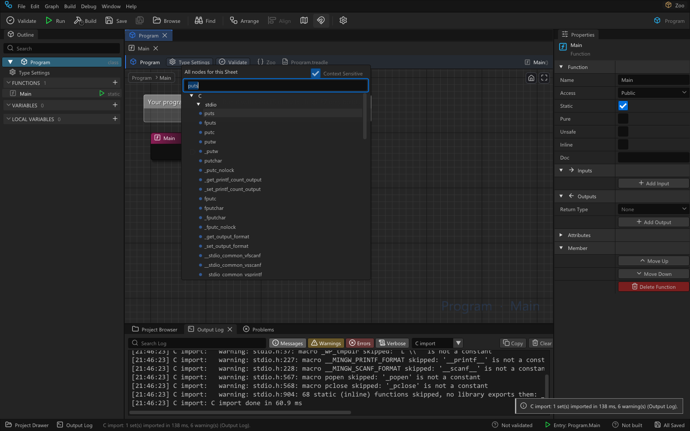

The set imports the whole of `stdio.h`, so the Output Log also lists the import's warnings about parts of the
header this program never uses. To keep just `puts`, select `Zoo.tproj` in the Project Browser: Properties
shows the project page. In its **C Imports** section, type `puts` in the `stdio` set's **Only** field, press
Enter, then click **Import Again**. The set now offers `puts` alone and the warnings are gone.
[C-Import.md](C-Import.md) says what else a set can say.

## Animal: a class with a virtual function

Nodes are placed the same way all through this page: drag a wire out of a pin, let go in empty space, type a
few letters of the node's name in the Node menu and press **Enter**, or click the row you want. The new node
comes wired to the pin you dragged from. The white arrow pins are flow pins; "from Entry" means from the
Entry node's flow output.

1. In the Project Browser click **+ Add > New Class...** (the same menu opens on a right-click on the `Source`
   folder). The Create Type dialog proposes `NewClass`: type `Animal` and press **Enter**. The dialog shows what
   it makes: `Animal.treadle` in the selected folder (`Source`), in the project's namespace `Zoo` (Type Settings >
   **Namespace** changes it). A new class starts with a constructor, and its Sheet opens.
2. **VARIABLES +** adds a variable. In Properties name it `mLegs`; its Type is already `int`.
3. **FUNCTIONS +** > **Function**. Name it `Speak` in Properties and set **Inheritance** to **Virtual**, so
   Dog and Bird can replace it.
4. On the Speak Sheet: from Entry, type `puts`, Enter. Click the text box on the new node's input and type
   `...` (text is quoted for you).
5. Click **Arrange** on the toolbar.

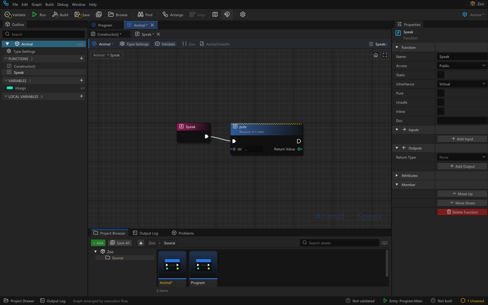

6. **FUNCTIONS +** > **Destructor**: its Sheet runs when an Animal is freed. From Entry place `puts` with the
   text `an animal is freed`.
7. **FUNCTIONS +** > **Function**, named `Legs`. In Properties tick **Pure** and set **Outputs > Return Type**
   to `int`. From Entry: `return`, Enter. Drag from the Return node's **Value** input: `get mlegs`, Enter.

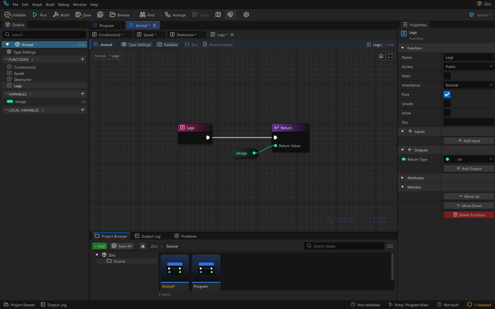

A pure function has no side effects, so its calls are value nodes: no flow pins, and they run when a flow node
needs their value. **Ctrl+Shift+S** saves everything; do it after each type.

8. The constructor New Class made runs when an Animal is made: click its row in **FUNCTIONS**. Under **Inputs**
   click **Add Input**, name it `legs`; its type is already `int`, and the Entry node gets a `legs` output. From
   Entry: `set mlegs`, then drag a wire from Entry's `legs` to the Set node's **Value**.

## Dog and Bird: a base constructor and an override

1. Right-click the `Animal` tile in the Project Browser > **Make Child Class...**. The dialog proposes
   `AnimalChild` with the Base Class `Animal`: name it `Dog`, **Enter**. (+ Add > New Class does the same when
   you pick `Animal` in its **Base Class** dropdown.)
2. Dog's constructor Sheet opens. A constructor runs a constructor of its base class first, so Make Child Class
   put **Base Constructor (int)**, Animal's constructor, after Entry: type `4` into its **legs**. In Properties,
   **Constructor** says which one it runs (a base class with several constructors lists them all there).

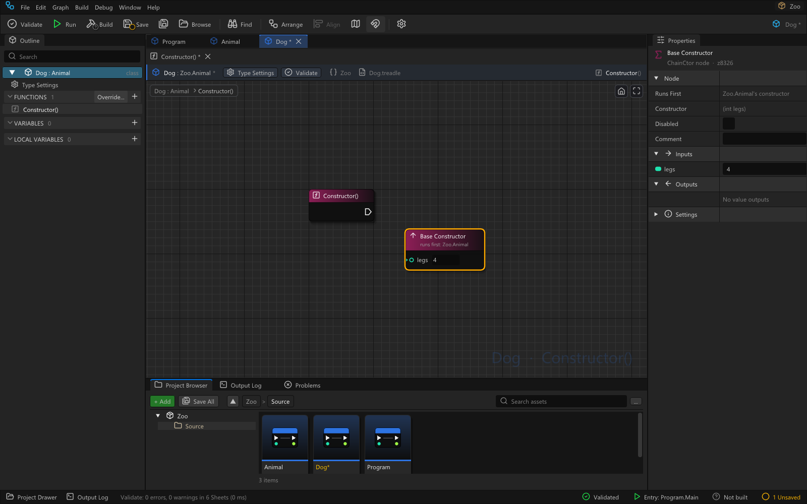

3. Animal's Speak is virtual, so the **Override...** button on the FUNCTIONS header lists it: **Override... >
   Speak** makes Dog's Speak with the same signature, **Inheritance: Override**, and opens it. From Entry place
   `puts` with `Woof`. The Outline marks an override with a red icon.

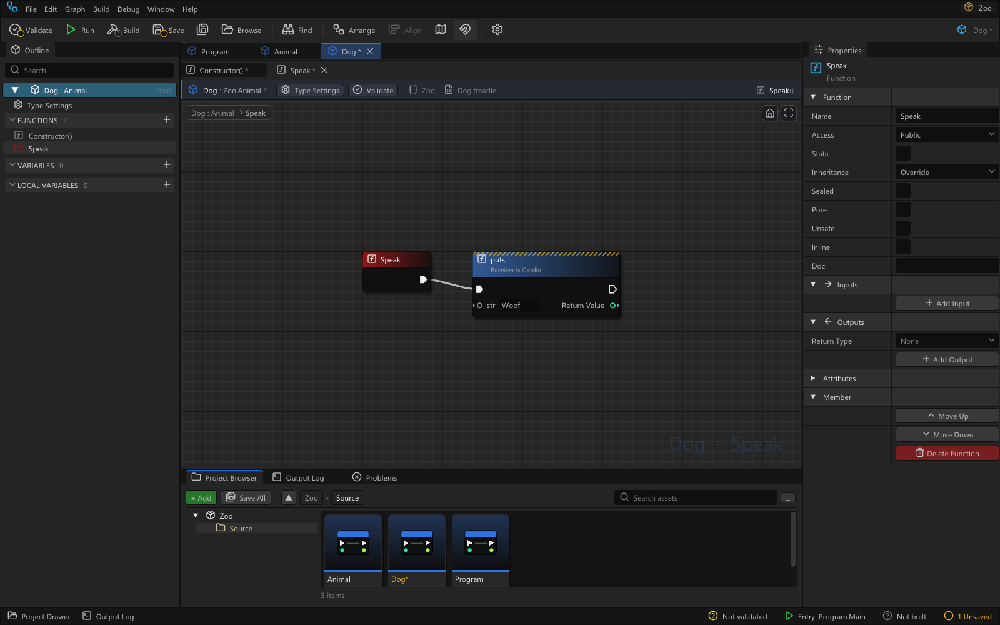

4. Make `Bird` the same way: **Make Child Class...** on Animal, `2` into the Base Constructor's legs, and
   **Override... > Speak** printing `Tweet`.

An abstract function of a base class (Inheritance: Abstract, no Sheet) has to be overridden: the child's Outline
then lists it under **REQUIRED OVERRIDES**, where **Implement** makes it.

## Point: a struct

1. **+ Add > New Struct...**, `Point`, **Enter**. A new struct has no members; Type Settings opens.
2. **VARIABLES +** twice: `X` and `Y`, both `int`.
3. **FUNCTIONS +** > **Function** `Sum`: **Pure**, Return Type `int`. From Entry: `return`. From the Return's
   **Value**: `+`. From the + node's **A**: `get x`; from its **B**: `get y`.

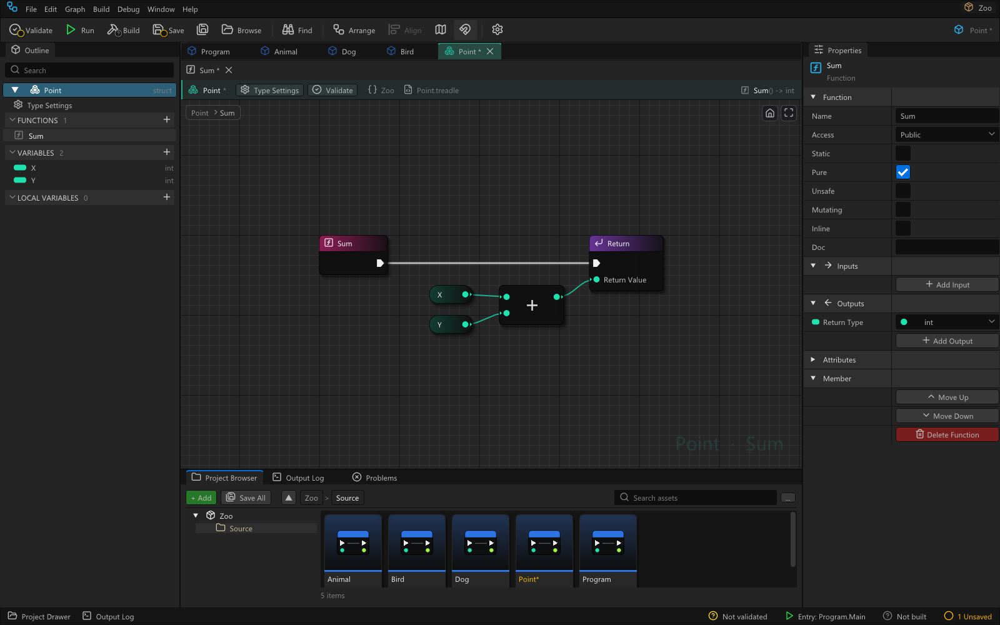

A struct is a value: copying it copies its fields, and nothing has to free it.

## Box: a generic class

1. **+ Add > New Class...**, `Box`, **Enter**. In Type Settings open **Generic Parameters** and click **Add
   Generic Parameter**: `T` appears.
2. **VARIABLES +**: name `mValue`, Type `T`.
3. Click the constructor's row in **FUNCTIONS**. Under **Inputs** click **Add Input**, name it `value` and
   pick the type `T` (under **Generic parameters** in the type picker). From Entry place `set mvalue`, then drag a wire from Entry's `value` to the Set node's **Value**.
4. **FUNCTIONS +** > **Function** `Get`: **Pure**, Return Type `T`. From Entry `return`; from its Value
   `get mvalue`.

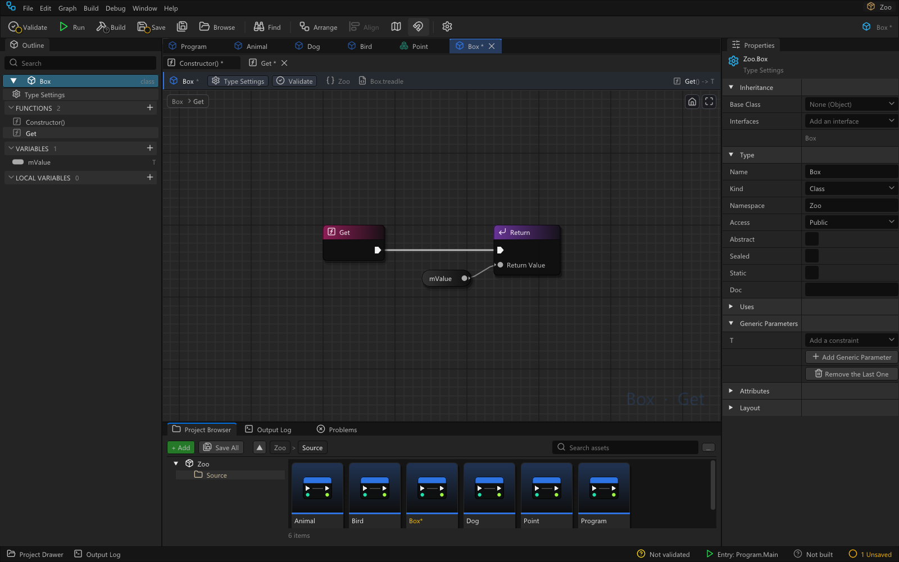

`Box<int>` and `Box<Point>` are separate types made from Box: each type argument gets its own compiled copy.

## Main: making objects

Double-click **Program** in the Project Browser, then **Main** in the Outline.

1. **LOCAL VARIABLES +** adds a local variable. In Properties name it `pet` and set its Type to `Zoo.Animal`.
2. From Entry: `construct dog`, Enter. **Construct Dog** makes a Dog on the heap. It is yours: you delete it.
3. From Construct Dog's flow output: `defer delete`. Wire Construct Dog's **Object** to its **Object**. The
   Dog is now deleted when Main ends, however it ends.
4. From Defer Delete's flow output: `local bird`. **Local Bird** makes a Bird that is freed by itself when the
   region it is in ends, here when Main returns.
5. From Local Bird's flow output: `defer`. From the Defer node's **Deferred** output place `puts` with
   `goodbye from Defer`; it runs at the end of Main too.

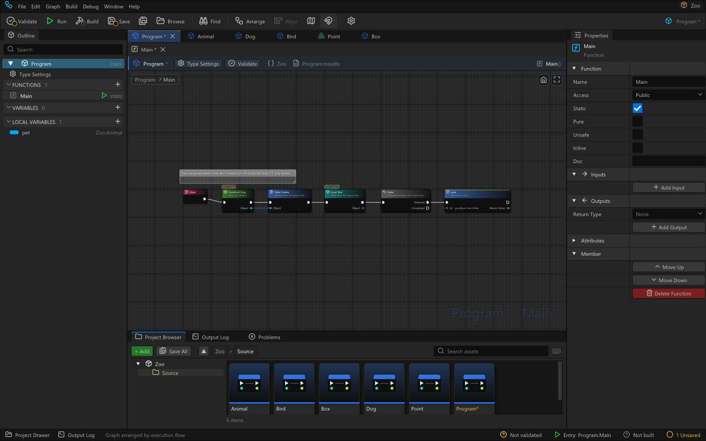

## Main: the loop

6. From Defer's **Completed**: `sequence`. A Sequence runs **Then 0** to its end, then **Then 1**.
7. From **Then 0**: `for loop`. Type `2` into its **Count** (Start stays `0`).
8. From the For Loop's **Index**: `==`, and type `0` into its second input. From **Loop Body**: `branch`. Wire
   the == node's result into the Branch's **Condition**.
9. From the Branch's **True**: `set pet`, and wire Construct Dog's **Object** into its Value. From **False**:
   `set pet` again, with Local Bird's **Object**.
10. From the first Set pet's flow output: `animal speak`, Enter: a call of Animal's Speak (the Node menu's
    search takes the words in any order, and a type's name finds its members). Wire the second Set pet's
    flow output into the same Speak node; both arms continue there.
11. From Speak's **Receiver** input (the object the call runs on): `get pet`.
12. From Speak's flow output: `writeline int`, Enter: the WriteLine that takes an int (a parameter's type
    picks the overload). From its **value**: `legs`. Wire Get pet's output into the Legs node's Receiver as
    well.

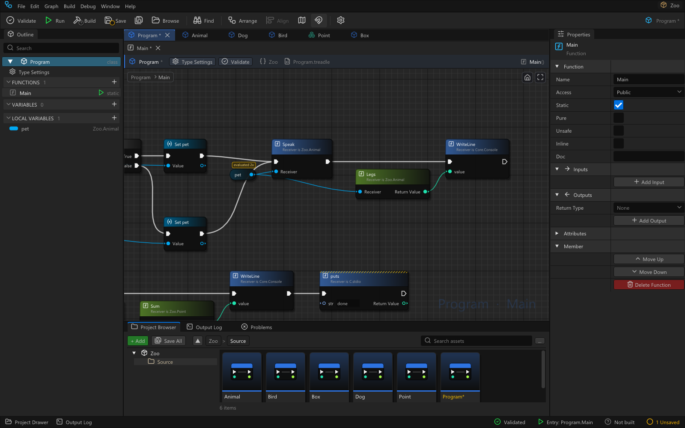

Get pet now says **evaluated 2x**: a value node runs again for every flow node that uses it, here for Speak and
for WriteLine (through Legs). That is cheap here. To compute an expensive value once, drag from its output and
place **Local Variable**: the value is stored once, and Get nodes read it.

## Main: the Box

13. From the Sequence's **Then 1**: `local box`, Enter: **Local Box (T)**, Box's constructor. In Properties set
    its **Type** to `Box<Point>`: the constructor follows, its **value** input is now a Point (Properties >
    **Constructor** shows `(Point value)`).
14. From Local Box's **value**: `make point`, and type `3` and `4` into X and Y.
15. From Local Box's flow output: `writeline int`, Enter. From its value: `sum`. From Sum's Receiver:
    `box get`. Wire Local Box's **Object** into that Get's Receiver too.
16. From WriteLine's flow output: `puts` with `done`.
17. **Arrange**, then **Validate** (Shift+F7). Problems stays empty. A problem would show as a red strip on its
    node, with the whole text in Properties and in Problems. Problems are shown when you Validate, Build or Run;
    after an edit the ones shown dim until the next Validate (**Editor Preferences > Build > Validate automatically
    after edits** shows them as you edit).

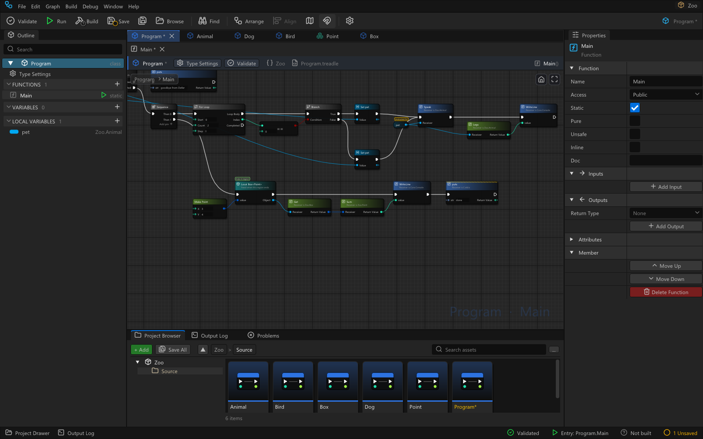

## Build and run

**Run** (Ctrl+F5, the toolbar's play button, first in the Build menu) saves every file, builds when needed and
runs the program; its output goes to the Output Log. **Build** (F7) only compiles, for checking errors or
making the exe to ship:

```
Woof
4
Tweet
2
7
done
goodbye from Defer
an animal is freed
an animal is freed
```

The loop runs twice: the Dog speaks and has 4 legs, then the Bird with 2. Then 1 prints 3 + 4 and `done`. When
Main ends, the Defers run last one first (the goodbye, then the Dog's delete), and then the Local Bird is freed.
The Output Log folds the two equal last lines into one marked `(x2)`.


## Debug it

1. Click the Speak node and press **F9**: a red dot marks the breakpoint (F9 again removes it). Only flow nodes
   take breakpoints.
2. **F5** (Start Debugging) builds in Debug and runs the program under the debugger. It stops on Speak: the
   node is outlined in yellow with an arrow, and the status bar says where.
3. Value pins show what they hold in small bubbles: Speak's Receiver reads `Zoo.Dog`. **Locals**, next to
   Properties, lists `pet` and the pin values of the nodes that ran; **Call Stack** shows how the program got
   here; **Debug Output** at the bottom has what the program writes, with the debugger's own lines dimmed.

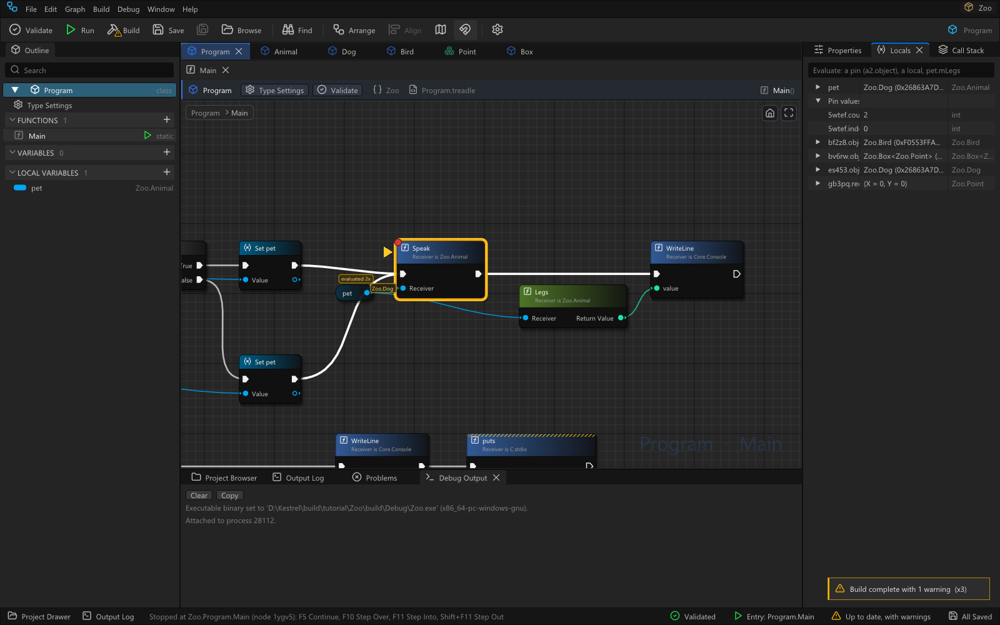

4. **F10** (Step Over) runs the node and stops on the next one. **F11** (Step Into) goes into the function the
   node calls: here Dog's Speak, whose Sheet opens. **Shift+F11** steps out, **F5** continues, **Shift+F5**
   stops the program.

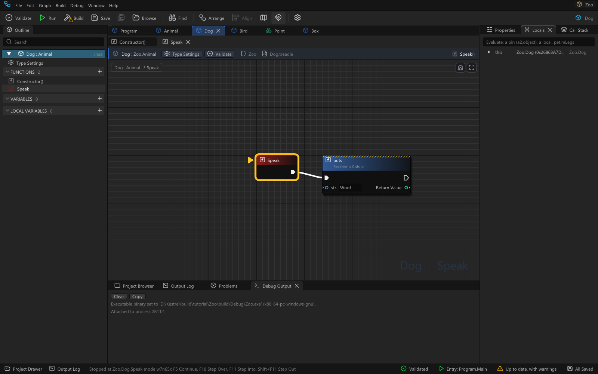

To see what is under the graph: **Type Settings > Layout** (click the type at the top of the Outline) shows
where each field of Dog or Point sits in memory, padding included, without a build; the Construct and Local
nodes say where their objects live (`lives in heap`, `lives in region`). After a build, right-click Main in
the Outline > **Disassembly** for its machine code grouped by node, with its Sheet IR and LLVM IR beside it;
while stopped, right-click `pet` in Locals > **Show in Memory** for the bytes of the Dog it references
([Debugging.md](Debugging.md), "Under the hood").

## What is different

* **Construct and Local are how objects are made.** Construct allocates on the heap and you free the object
  with a **Delete** node (or an owner does). Local allocates in the current **region** (a loop body, a Branch
  arm, the function) and the object is freed when that region ends. Both are flow nodes, so each runs exactly
  once, where the flow reaches it.
* **There is no garbage collector.** Every object is freed exactly once, by you or by its region. Debug builds
  check this: at exit they list every object never deleted with the Construct node that made it, and a second
  Delete or a use of a deleted object stops the program on the node.
* **Defer** runs its Deferred output when the region ends, by any route, last Defer first. **Defer Delete**
  is the common case: delete this object when we leave.
* **Value nodes run once per flow node that uses them.** Nothing is cached between flow nodes. A value node read
  by several flow nodes says **evaluated Nx**. Pure functions are value nodes; a function with side effects is
  a flow node.
* **Errors are values, not exceptions.** A function that can fail returns `Result<T>` or `Option<T>`.
  **Result: match** branches on it, **Try** passes an error up to the caller, and **Fatal** stops the program
  with a message.
* **C is called directly.** A C import set turns C headers into nodes in the Node menu's **C** group. Pointers
  and C callbacks are allowed in Sheets marked **Unsafe** ([C-Import.md](C-Import.md)).
* **A member call names its Receiver**, the object it runs on. Left unwired in a type's own Sheets, it is the
  object itself (`this`).

## The core library

Every program can use the core library without importing anything; in the Node menu it is the **Core** group.
It has `String` and `StringView` (text you own, and a view of text), `List<T>` and `Dictionary<K,V>`, `Console`
(Write, WriteLine, ReadLine), `Math`, `Option<T>` and `Result<T,E>`, and `Environment` for the program's
command-line arguments. The ownership rules above apply: a `String` you construct is yours to delete, and a
`List` owns its storage but not the objects in it. [Core-Library.md](Core-Library.md) lists every type and
function.

## Where to go next

* [Core-Library.md](Core-Library.md): the core library type by type, and who owns what.
* [C-Import.md](C-Import.md): writing a `.cimport` set, what each C declaration becomes, the limits.
* [Debugging.md](Debugging.md): breakpoints, steps, pin values, Locals and fatal errors in detail.
* [Linux.md](Linux.md): installing and running Treadle on Linux.
* [Keyboard.md](Keyboard.md): every keyboard shortcut of the editor.
* `samples\m1` in the Treadle folder is a version of this program, and `samples\m3-core` counts words with the
  core library.

## Report a problem

**Help > Report a Problem** puts together a bug report on your computer. Nothing is sent from the editor: it
works the same with no network, and nothing leaves your machine unless you upload it yourself.

1. Type what went wrong and the steps that make it happen.
2. Choose what goes in: the last 200 lines of the Output Log and the last crash report are ticked; **Include
   this project's files** is not (tick it only if the problem needs your project; the `build` and `.git`
   folders are always left out).
3. The list under **In the bundle** shows every file with its size, and the version line. That is all the
   bundle holds. A bundle can be at most 8 MB; a larger one is refused (untick the project files).
4. **Report on GitHub** saves the bundle, then opens a new issue on the project's GitHub page in your browser,
   filled in with your text, the version, your Windows version and the last lines of the Output Log. Read it,
   drag the saved zip into the issue, and submit it there. **Save bundle** only writes the zip, to
   `%LOCALAPPDATA%\Treadle\reports\report-<id>.zip` (the path is shown, with a Copy button). **Copy summary**
   puts a short text (version, Windows version, your description and steps, the bundle's path) on the
   clipboard, to paste in the support chat (**Open support chat**, when the build has one) with the zip
   attached.

What is in a report: `report.txt` (the version line, the Windows version, a report id, the time, your text and
which boxes were ticked), and only if ticked: `output-log.txt`, the newest crash report from
`%LOCALAPPDATA%\Treadle\logs`, and your project's files under `project\`. What is not: no other files, nothing
from other projects, nothing sent in the background. File paths in the log, the crash report and the issue
text can show your Windows user name; read them before you post.

## From the command line

```
Treadle.exe <project folder>                         open a project
Treadle.exe --build-run <project folder> [-- args]  build and run, print the output, exit
Treadle.exe --import-c <file.cimport> [--out <dir>] import C headers without a window
Treadle.exe --version                                print the version
Treadle.exe --update [--check-only]                 look for a new version and install it
```

`--build-run` exits with the program's result: 0 when the program ran, 3 when the build failed (each problem is
printed with the node it is on). The program runs in the project folder, as from a terminal there: a relative
argument or file name (`-- data.json`) is read from the project folder. Run (Ctrl+F5) in the
editor runs it in its build folder (`build\Debug` or `build\Release`).

## What is in the folder

| Path | What |
|---|---|
| `Treadle.exe`, `treadlehost.dll` | the editor |
| `core\` | the core library every program uses |
| `tools\llvm\` | the compiler back end, linker and debugger |
| `tools\libclang\` | used only by the C header import |
| `tools\runtime\` | the small C runtime compiled into every program |
| `tools\SDL2\` | SDL2 2.32.10 (headers, import library, `SDL2.dll`) for the SDL samples |
| `samples\` | the sample projects; `samples\README.md` lists them |
| `docs\` | these pages and their pictures |
| `LICENSE`, `NOTICE`, `THIRD_PARTY.md`, `THIRD_PARTY\` | Treadle's licence and those of the bundled components |
| `VERSION.txt` | the version of this package |
| `files.txt` | the list of the package's files (the updater replaces files by it) |
| `update\` | made by the updater: downloads, its log `update.log`, the copy it can roll back to |

## Updating

Treadle updates itself from its GitHub Releases (https://github.com/AproposRobin/Treadle/releases). Once a day, a
few seconds after it starts, it looks for a newer version; **Help > Check for Updates** looks at any time. When
one is found, a line under the toolbar says so: **Update now** downloads it (the progress is in the status bar)
and checks it against the release's SHA256SUMS, **What changed** shows the release notes, **Later** hides the line
until the next start, **Skip this version** never offers that version again. When the download is checked,
**Restart to finish** saves your files, closes Treadle, replaces the program's files and starts the new version with
the same project. Your projects, settings and anything you added to the Treadle folder stay as they are; if the
new version does not start, the old one is put back. `update\update.log` in the Treadle folder says what happened.

**Editor Preferences > Updates** has the settings: **Check for Updates** (on), **Channel** (Alpha, the default,
also gets pre-releases; Stable only full releases) and **Work Offline**, which stops every network request.
Without a network nothing changes: a failed check is only logged. If the Treadle folder cannot be written to (for
example under Program Files), the line says so and gives the release link: download and unzip the new version by
hand. **Help > About Treadle** shows the version you have.

## Samples

The `samples` folder of the Treadle folder holds sample projects, from the zoo of this page (`m1`) to a Breakout game
(`m4-breakout`), a JSON reader and writer (`m5-json`) and a small virtual machine (`m6-vm`). `samples\README.md`
lists them with one line each and says how to open and run them: **Open a sample...** on the start page, File >
Open Project Folder..., or `Treadle.exe --build-run samples\<name>` from a terminal. Each sample has its own
README with what it shows and the command that runs it. `m2-sdl`, `m4-breakout` and `m7-particles` draw with SDL2, which the
Windows package carries in `tools\SDL2`; on Linux see `samples/README.md`, "SDL2".
