# Language guide

This page explains how Treadle programs behave. It assumes you have done [Getting-Started.md](Getting-Started.md)
and know a language like C#, C++ or another node-graph scripting editor. Every example graph is a small,
complete function that builds and runs; the text says what it prints.

If you know C#: Treadle has classes, structs, interfaces, generics and delegates much as you expect, but **no
garbage collector** and **no exceptions**. If you know C++: memory is manual, but scoped allocation, `defer`
and the Debug runtime's checks do most of the bookkeeping. If you know node editors: flow pins, value nodes,
Entry and Return work as you expect; the differences are in how often value nodes run (section 1) and how
objects are made and freed (section 3).

## 1. How a program is built

A **project** is a folder with a project file (`<Name>.tproj`) and its type files. Every **type** (a class,
struct, interface, enum, delegate type or extension) is one file, `<Type>.treadle`, with all its members. Node
positions live in a separate layout file in the project's `layout` folder (`layout/<Type>.layout`), so moving a node never changes the program. The files
are text, made to be read in a diff and merged with git.

A type's members are listed in the **Outline**: **FUNCTIONS** (functions, properties, constructors, the
destructor), **VARIABLES** (the type's fields) and **LOCAL VARIABLES** (of the function in front). **Type
Settings** holds the type's own settings: name, kind, namespace, base type, interfaces, generic parameters.

Each function body is a **Sheet**: a node graph in its own tab. A Sheet has one **Entry** node, whose outputs
are the function's inputs, and any number of **Return** nodes, which take the result.

A program starts at the static `Main` of the project's **entry** type (`entry` in the project file; New Project
makes `Program.Main`, and the status bar names it). Any type's static `Main` (no inputs, or `Args : String[]`;
returning `int` or nothing) can be the start: **Set as entry point** in its Outline menu writes `entry` for you.

Pins come in two kinds:

* **Flow pins** (the white arrows) say in which order things happen. A **flow node** has a flow input and one
  or more flow outputs: it runs when flow reaches it, then follows one output. Calls of ordinary functions,
  Set, Branch, loops, Construct and Return are flow nodes. A flow input takes any number of wires: a node
  reached from both arms of a Branch runs after whichever arm ran.
* **Value pins** carry typed data. A **value node** has no flow pins: Get, operators, Make and Break, Select,
  literals, and calls of **Pure** functions. A value node does not run on its own; it is computed when a flow
  node needs it.

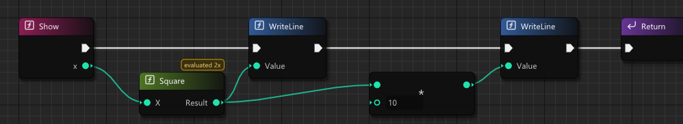

### Evaluation order

Three rules decide what runs when:

1. **When.** When a flow node runs, its value inputs are computed first, top pin to bottom pin, each one
   through the value nodes that feed it. Then the node itself runs.
2. **How often.** A value node is computed **once for each flow node that uses it, every time that flow node
   runs**. Feeding two inputs of the same flow node counts once. Nothing is remembered between flow nodes.
3. **What it reads.** A value node that reads a flow node's output (a call's result, a Construct's Object, a
   loop's Index) sees the value from the last time that flow node ran, and may only be used where that flow
   node has certainly run. Elsewhere the reader shows the error "may not have run".

In the picture, `Show(4)` prints `16`, then `160`. **Square** feeds both WriteLines, so it runs twice; after
**Validate** (Shift+F7) the node says **evaluated 2x**. Here that costs nothing. When a value is expensive, or
must not change between two uses, right-click its output pin and choose **Make local variable**: the value is
stored once by a Set in the flow, and Get nodes read the stored value.

`And` and `Or` compute their second input only when needed, and **Select** computes only the input it picks.

## 2. Types

| Kind | Value or reference | Notes |
|---|---|---|
| **class** | Reference | One base class, any number of interfaces, virtual functions, a destructor |
| **struct** | Value (copied) | No base class; may implement interfaces |
| **interface** | Reference to a class that implements it | Functions and properties to implement |
| **enum** | Value | Named numbers, or cases that carry values (payload enums) |
| **delegate** | Reference | A function type (`signature int(int)`); its values are delegates |
| **extension** | - | Adds members to another type |

The built-in types are `bool`, `int8` to `int64`, `uint8` to `uint64`, `float`, `double`, `char8` (one UTF-8
byte), `char32` and `void`. **`int` is 64-bit** and `uint` too; a C `int` is `int32`.

**Classes.** A class value on a pin is a reference: two pins can name the same object, and a change through
one is seen through the other. A class reference may be `null`; test it with an `==` or `!=` node against
`null` feeding a Branch. Using a member of `null` stops a Debug build with a fatal error on the node.

**Structs.** A struct value on a pin is a copy. Passing a struct to a function copies it; a function that
changes its own struct's fields is marked **Mutating** (section 6). **Make** builds a struct from its fields and
**Break** splits one; right-click a struct pin and **Split Struct Pin** to show it as one pin per field on the
same node. A struct may have a destructor: it runs when a Local of the struct ends, with the object that holds
it as a field, for each element of an array of it, and for a **local variable** of the struct when the function
returns and when a Set replaces its value (the old value is destroyed; a local starts as the zero value, which
the first Set destroys, so a destructor must accept zero fields). Because a struct is copied bit for bit, a copy of a
struct with a destructor would be destroyed twice; the compiler warns (T3064) where a Set, a Call input or a
Return copies one out of a variable. Add the attribute **Copyable** (Type Settings > Attributes) when copies
are meant.

**Interfaces.** A class lists the interfaces it implements in Type Settings (**Add Interface**). A call
through an interface-typed Receiver runs the implementing class's function. A struct that implements an
interface is called directly.

**Enums.** A simple enum is named integers (with the attribute `Flags` for bit flags). A **payload enum** has
cases that carry values, like a tagged union: `Shape` below has `Circle(radius)` and `Rect(w, h)`. Three nodes
work with them:

* **Make Case**: builds a case from its values (`Make Shape.Circle` with `radius 2.0`).
* **Switch**: one flow output per case, with that case's values as pins (`Circle.radius`, `Rect.w`,
  `Rect.h`), plus **Default** (a case not listed) and **Completed** (after the arm that ran).
* **Is Case**: a value node giving `bool` and the case's values, to be read only where it said true.

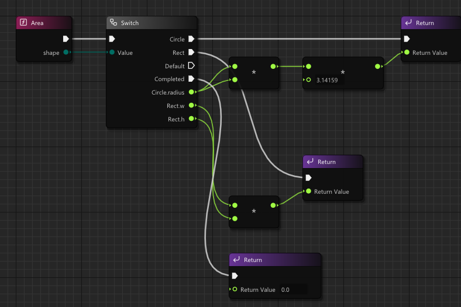

`Area(Make Shape.Circle radius 2.0)` prints `12.56636`. Switch also works on integers, characters and text
(each case label is the text itself) with the same Default and Completed outputs.

**Tuples.** `(int,int)` is a value with no type file. **Make (int,int)** builds one, **Break (int,int)** gives
`item0` and `item1`, and a function can return one.

**Generics.** A type gets generic parameters in Type Settings (**Add Generic Parameter**); a generic
function's pins show `T` in grey. Each type argument gets its own compiled copy (`Box<int>` and
`Box<float>` are separate types), so generics cost no speed. A parameter's constraints say what the
generic code may do with it:

| Constraint | Allows |
|---|---|
| an interface (`IHashable`) | calling its functions on a `T` |
| `class`, `struct`, `enum` | only that kind of type |
| a base class | its members; `T` is it or a class derived from it |
| `delete` | Delete of a `T` (needed by `List.DeleteAll`) |
| `new` | Local `T`, and Construct `T` together with `class`: the constructor without inputs runs |
| `operator>`, `operator+`, ... | that operator on `T` values |

Without constraints, a `T` can only be copied, passed along, set to `default`, and compared with `==` when it
is a value type that has one.

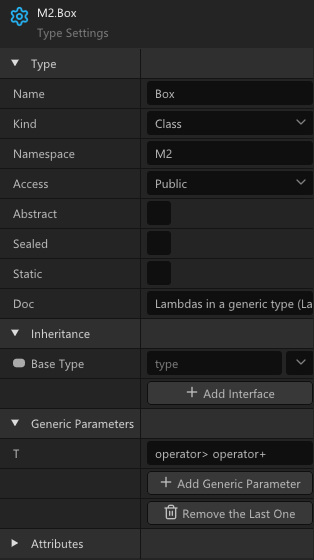

**Extensions.** A type of kind **Extension** adds functions, properties and operators to another type: your
own, a core type such as `String` or `List<T>`, or a C struct. They are listed in the Node menu under the
extended type, and `this` in their Sheets is that type. Fields can be added only to a type of the same project;
extension functions are never virtual.

**Delegates and events.** A delegate type names a signature. **Bind Function** makes one from a function: with
no Allocation it gives a plain function pointer of a static function; with Allocation **Construct** or **Local**
it gives a delegate of any function, with its Receiver. **Invoke** calls it with `arg0`, `arg1`, ... A Lambda
(section 6) is the other way to make one. An **event** is a field of a class whose type is a delegate type
returning nothing, with the attribute `Event`. Its nodes are **Add**, **Remove**, **Invoke**, **Clear** and
**Count**. The event owns its handlers: add delegates made with Construct, and Remove, Clear or the object's
destructor deletes them.

**Arrays and Span.** `T[]` is a reference to a fixed number of elements, made by Construct or Local with a
**Count** input; Get [ ] reads an element and Debug builds check the index. `Span<T>` is a pointer and a
length over elements someone else owns: an array wires straight into a Span input, and `List.Slice` gives one.
For Each walks both.

**Strings.** Text is UTF-8. `String` is a class that owns its bytes (you delete the ones you construct);
`StringView` is a struct holding a pointer and a length into someone else's text, valid while that text lives
and is unchanged. A String wires into any StringView input. A text literal typed on a StringView input is the
text itself; on a String input it becomes a String of the function, freed when the function returns.
`Length()` counts bytes; `CodePointCount()` counts characters, and For Each over `CodePoints()` walks them.
For a number, a bool, an enum or a struct that may be missing, use a **nullable** `T?` (`int?`): it holds a `T` or
`null`; a `T` wires into a `T?` input. Test it with an `==` or `!=` node against `null`, compare two `int?` with
`==` (equal when both are null or both hold equal values), and get the value with a **Cast** to `T`: a Cast of a
null is a fatal error naming the node, and a checked Cast (Properties > Checked) takes its **Failed** output
instead. `Option<T>` (section 5) does the same job for any type, with Switch and Is Case. The whole API is in

[Core-Library.md](Core-Library.md).

**Math types.** The core has the vectors, matrices and shapes a game or a tool needs: `Vec2`, `Vec3`, `Vec4` (and
`Vec2d` ... `Vec4d` in double), `Mat3` and `Mat4` (column-major, as shaders read them), `Quat` (rotations), `Color`
and `Color32`, `Rect` and `RectI`, `AABB`, `Plane`, `Ray` and `Transform`. They are plain structs laid out as C lays
them out, so an array of `Vec3` goes to a C library or a vertex buffer as it is. Their functions are Pure value
nodes (`Dot`, `Normalized`, `Lerp`, `Cross`, `Inverted`, `Slerp`, `IntersectAABB`, ...), and the Operator node and
the Math Expression work on them: `p + v * dt` moves a point, `projection * view * model` chains matrices, `q * v`
rotates a vector. Angles are radians, Y is up and -Z forward. Append and AppendF write them as `(1, 2, 3)`. The full
list is in [Core-Library.md 4.5](Core-Library.md#45-the-math-library).

## 3. Memory

There is no garbage collector. Every object is freed exactly once: by you, by its owner, or by the region it
was made in.

| Node | What it does | Who frees it |
|---|---|---|
| **Construct `T`** | Makes a `T` on the heap and runs a constructor | You, with **Delete** (or an owner) |
| **Local `T`** | Makes a `T` that belongs to the current region | Its region, when control leaves it |
| **Delete** | Runs the destructor and frees the memory; Delete of `null` does nothing | - |
| **Defer** | Runs its **Deferred** output when control leaves the region | - |
| **Defer Delete** | A Defer whose body deletes one object: the usual partner of Construct | - |

A **region** is the part of a Sheet that a body output owns: a loop's Loop Body, a Branch arm, a Sequence's
Then output, a Switch case, a Scope's Body, a Defer's Deferred, and the whole function. Regions nest. Control
leaves a region by falling through to the owner's next output (Completed), by Break or Continue, or by
Return. A Local in a loop body is made and freed on every pass. When a region ends, its Defers run first,
the last one first, and then its Locals are freed, so a deferred action can still use them.

Construct and Local are flow nodes on purpose: making an object is an action that must happen exactly once, at
a known point. **Change to Construct / Local** on the node's menu switches between them.

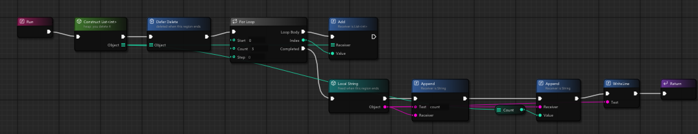

This function makes a `List<int>` on the heap and registers its Delete at once with Defer Delete. The loop adds
0, 1 and 2. After the loop a **Local String** is built and printed: `count 3`. When the function returns, the
Local String is freed and the list is deleted, with no Delete node in the flow.

The rules the compiler checks:

* A Local's Object may be used only inside its region (nested regions included). Returning it is an error
  ("returns a Local's object, which is freed when the function returns"); storing it in a field is a warning.
* A Delete of an object that is already deleted on every path to it is an error before the program runs;
  the Debug runtime catches the cases the compiler cannot see.
* A field marked **Owned** (its Ownership in Properties) is deleted by its object's destructor. A **local
  variable** marked Owned is deleted when the function returns, by every Return (one never set holds `null`,
  which Delete ignores).

### Debug and Release

| | Debug (`checks on`) | Release (`checks off`) |
|---|---|---|
| Objects never deleted | Listed at exit with their type and the Construct node that made them; a program that would exit 0 exits with the number of leaks | Not checked |
| A second Delete, use after Delete | Fatal error naming the node | Not checked: undefined behaviour |
| Member of `null` | Fatal error naming the node | A crash |
| Index out of range (arrays, spans, List) | Fatal error with the node and the index | Not checked |
| Integer overflow | Not checked (wraps) | Not checked |

A leak report looks like this:

```
leak: Core.String (32 bytes) made at Game.Program.Main node a2
```

### Who deletes what

* **Whoever constructs it**, unless it is handed to an owner. Put a Defer Delete right after the Construct when
  the object lives until the function ends.
* **Containers own their storage, not your objects.** A `List<String>` frees its array when deleted, but not
  the Strings in it: call `DeleteAll` first, then Delete the list. `Dictionary` has `DeleteKeys` and
  `DeleteValues`.
* **Functions that return new objects say so.** `String.Concat` returns a String you own; `Substring`,
  `Split` and `Trim` give views of the same text. [Core-Library.md](Core-Library.md) lists every case.

### Pure functions

A function marked **Pure** (Properties) has no side effects, so its calls are value nodes. Because a value
node runs once per flow node that uses it, a hidden side effect would run an unknown number of times; Pure is
therefore checked. A Pure function may use loops, Branches, its own local variables and **Local** objects,
but it may not **Construct** ("a Pure function may not Construct (a Local is fine)"), Set a field of `this` or
of another object, or call a function that is not Pure. Property getters are Pure.

## 4. Control flow

| Node | Outputs | What it does |
|---|---|---|
| **Branch** | True, False | Follows one arm by its Condition |
| **Sequence** | Then 0, Then 1, ... | Runs each output's nodes to their end, in order |
| **For** | Loop Body (with Index), Completed | From Start, Count times (Count is read once), by Step |
| **For Each** | Loop Body (with Element, Index), Completed | Over an array, a Span, a String (its bytes), a List, a Dictionary (key-value tuples), or any type with `GetEnumerator` |
| **While** / **Do While** | Loop Body, Completed | Checks the Condition before / after each pass |
| **Break** / **Continue** | - | Leaves / restarts the innermost loop |
| **Switch** | one per case, Default, Completed | On integers, characters, text, enums (section 2) |
| **Scope** | Body, Completed | A region of its own, so its Locals and Defers end early |
| **Select** | (value node) | Picks one of two values; computes only the one it picks |
| **Math Expression** | (value node) | A formula such as `a * b + 1`; every name in it becomes an input |

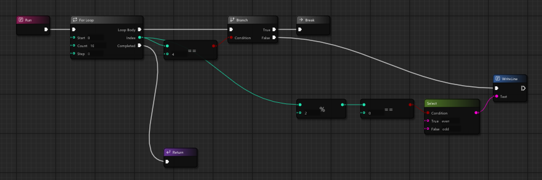

This prints `even`, `odd`, `even`, `odd`: at index 4 the Branch takes **Break**, and the flow continues at the
loop's **Completed**.

### Gates and their state

**Gate**, **Do Once**, **Do N**, **Flip Flop** and **Multi Gate** remember something between runs: whether
the gate is open, whether Once has run, how many times Do has run, which side Flip Flop took last, which
output Multi Gate runs next. That memory is a hidden field of the type the Sheet belongs to, one per node and
**per object** (static when the function is static), named after the node: `__gate_<node>`, `__doOnce_<node>`,
and so on. **Open Gate**, **Close Gate**, **Toggle Gate** and the **Reset** nodes change it. The node's **State
Field** in Properties can name a visible field of the type instead. In a struct's function the state must be a
named field and the function Mutating, since a struct value would carry it.

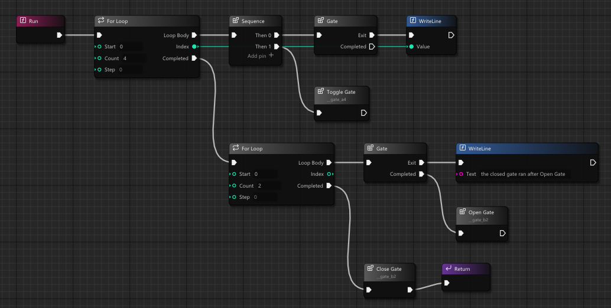

## 5. Errors

Treadle has no exceptions. A function that can fail returns its result as a value:

* **`Result<T, E>`**: `Ok(value)` or `Err(error)`. `Int.Parse(text)` returns `Result<int, ParseError>`.
* **`Option<T>`**: `Some(value)` or `None`.

Both are ordinary payload enums, so Switch, Is Case and Make Case work on them. Three nodes make them easy:

* **Result: match**: flow outputs **Ok** (with **Value**), **Err** (with **Error**) and **Completed**.
* **Try**: if the Result is an Err, returns that error from the current function at once; otherwise continues
  with the **Value**. The function must itself return a `Result` with the same error type; keep its value
  type the same as well, as `Doubled` below does.
* **Unwrap** (a flow call): the value, or a fatal error when there is none. **UnwrapOr** gives a fallback
  instead.

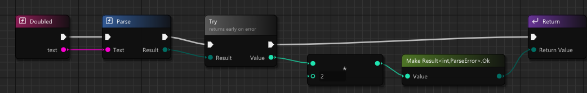

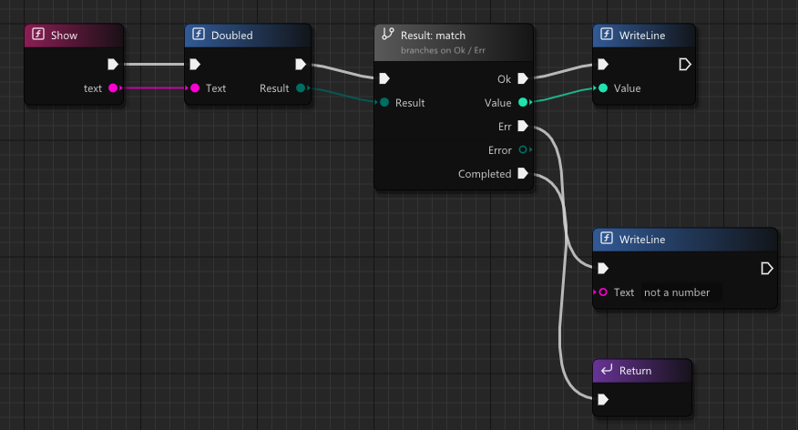

`Show("21")` prints `42`; `Show("abc")` prints `not a number`, because Try returned Parse's error from
Doubled and Result: match took **Err**.

For what cannot be handled, the **Fatal** node stops the program: its message goes to stderr, followed by a
line naming the node (in Debug), and the program exits with code 3:

```
config file missingfatal: Fatal node at Game.Program.Main node a2
```

The Debug runtime's own checks (section 3) stop the program the same way, naming the node; when the editor
runs it under the debugger, the Sheet opens on that node ([Debugging.md](Debugging.md)).

## 6. Functions

A function's **Inputs** and **Outputs** are set in Properties (**Add Input**, **Add Output**). The first
output is the Return Type; further outputs are extra values the Return node takes, one pin each.

**Receiver.** A call of a member function has a **Receiver** pin: the object it runs on. Left unwired in the
type's own Sheets, it is the object itself (`this`). A function marked **Static** has no Receiver.

**Mutating.** A struct's function that changes the struct's own fields is marked **Mutating** (Properties, on
struct functions). A call of it changes the place its Receiver names: a local variable, a parameter, a field,
an element of an array or span. The Receiver must be such a place: a Mutating call on a temporary value (a
Make, a call's result, a property, a For Each element) is error T2272, "cannot mutate a temporary", since the
change would be lost. Store the value in a local variable first. A function that is not Mutating gets a copy
of its Receiver and cannot change it.

**Overloads.** Two functions may share a name when their input types differ. The Node menu lists each one,
and typing a parameter's type picks it: `writeline int` finds the WriteLine that takes an `int`.

**Inheritance.** A class function's **Inheritance** is None, **Virtual**, **Abstract** (no Sheet; the class
cannot be constructed), **Override** or **Sealed Override**. The Outline marks overrides. Functions that are
not virtual are called directly. The **Base** node, used as a Receiver, calls the base class's version from
an override.

**Properties.** **FUNCTIONS +** > **Property**. An auto property keeps its value in a hidden field; otherwise
it has a getter Sheet and a setter Sheet (whose input is the new value). Get and Set nodes use a property like
a field.

**Constructors and destructors.** **FUNCTIONS +** > **Constructor** adds one; a type may have several with
different inputs, and Construct or Local picks one (Properties > Constructor). A constructor can first run
another one: a **Base Constructor** node (a constructor of the base class) or a **This Constructor** node
(another constructor of the same type). A class's **Destructor** runs on Delete and when a Local ends, derived
class first, then base.

**Lambdas.** A **Lambda** node holds a nested Sheet (its own tab, **Lambda** under the function in the
Outline) and gives a delegate. Drag a wire out of a delegate input and pick Lambda: the type, the inputs and
the Sheet's Entry and Return are filled in from the input. The Lambda's Sheet can read the function's inputs,
local variables and `this`: these are its **captures**, listed in Properties and counted in a badge on the
node.

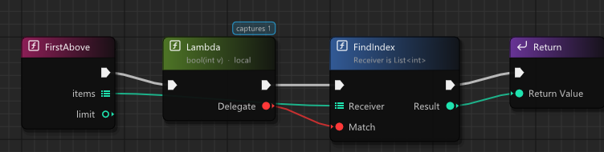

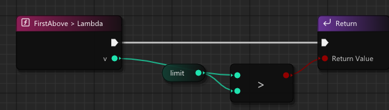

`FirstAbove([3, 9, 12], 5)` returns `1`, the index of 9. How a Lambda is allocated decides who frees it:

| Allocation | Freed | Captures |
|---|---|---|
| **Local** | When its region ends; it may not be returned or deleted | By value, or **by reference** (writes reach the captured variable) |
| **Construct** | By you, with Delete, or by an event it is added to | By value only |
| **Function pointer** | Nothing to free | None; for C callbacks |

A Lambda dragged from an input of a call is made Local, which suits a callback used during the call, as here.
Return a Construct Lambda when the delegate must outlive the function.

**Extract to Function.** Select nodes and press **Ctrl+Shift+E** (or **Extract to Function** in the node's
menu): they move into a new function of the type, a Call of it takes their place, and the wires that crossed
the selection become its inputs and outputs.

## 7. Calling C

A **C import set** (a `.cimport` file naming C headers) turns a C library into nodes in the Node menu's **C**
group, with no wrapper to write: `puts`, SDL, or your own library. **File > Import C Headers** makes one.
Calling a C function, even one that takes or returns pointers, needs no marker. Pointer arithmetic, reading
or writing through a pointer, and calling through a raw function pointer are **unsafe nodes**: they are allowed
only in a function marked **Unsafe** in Properties or inside an Unsafe Scope. [C-Import.md](C-Import.md) says
how to write a set and what each C declaration becomes.

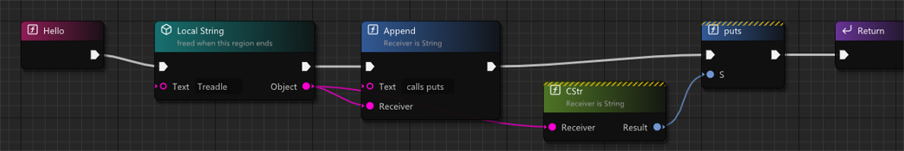

This prints `Treadle calls puts`. `CStr()` gives a zero-terminated `char8*` that is valid while the String
lives.

## 8. Projects

**Kind** (the project's Properties, from its tile in the Project Browser):

* **console**: a program with a console window. Its entry type has a static `Main`, which may take `Args`
  (`String[]`, the command-line arguments) and may return an `int`.
* **windowed**: the same program without a console window. Run still shows its Console output in the Output
  Log.
* **library**: a DLL (`lib<Name>.so` on Linux) with no Main. Its static functions with the attribute
  `Export("name")` are exported under that name with the C calling convention; the program using the library
  calls `treadle_init` before them and `treadle_shutdown` after.

**Configs.** A project has build configs, each a few keys in the project file:

| Key | Values | Default |
|---|---|---|
| `optimize` | `0` to `3`, or `size` | `2` in a config named Release, else `0` |
| `checks` | `on`, `off` | `off` in Release, else `on` (section 3) |
| `define` | `NAME` or `NAME=value` | none |
| `debugFormat` | `dwarf`, `codeview`, `both` | `dwarf` |

Select the project file's tile in the Project Browser: Properties shows the Kind, the **Active Config** (the
one Build and Run use) and each config's keys, whose values you can edit there. A new config or key is a few
lines added to the project file in a text editor; this one is an optimized build with the Debug checks on:

```
config Profile
	optimize 2
	checks on
	define PROFILE
```

Each config builds into `build/<config>/`. From the command line,
`Treadle.exe --build-run <project folder> --config Profile` builds and runs that config.

**Build constants.** `Build.IsDefined("NAME")` (a `bool`) and `Build.Value("NAME")` (a `StringView`, empty for
a bare name) are constants of the build: a Branch on one takes the same arm on every run, and an optimized
build drops the other arm. The name must be typed on the node, not wired.

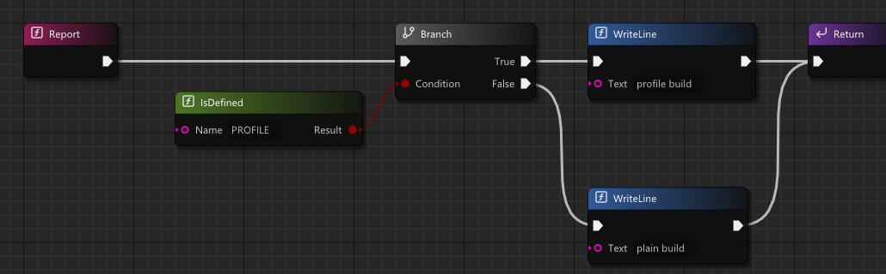

Built with `--config Profile`, this prints `profile build`; with Debug or Release, `plain build`.

## 9. Glossary

Habits from other node editors and the Treadle names for them:

| If you are used to | In Treadle | Notes |
|---|---|---|
| Target pin | **Receiver** | Unwired in the type's own Sheets: `this` |
| Self node | **This** node | |
| Exec pin, execution wire | **flow pin**, flow wire | |
| Pure node | **value node** | A Pure function's calls are value nodes, checked to have no side effects (section 3) |
| Function call with exec pins | flow node (a Call) | |
| Construct Object | **Construct** | Heap; you delete it |
| (none) | **Local** | Freed when its region ends |
| Destroy | **Delete** | Frees at once; Debug catches a second Delete |
| Graph | **Sheet** | One per function, constructor, destructor, property accessor, Lambda |
| Members panel | **Outline** | FUNCTIONS, VARIABLES, LOCAL VARIABLES |
| Class settings | **Type Settings** | |
| Details panel | **Properties** | Whatever is selected |
| Asset browser | **Project Browser** | Ctrl+Space opens it as a drawer |
| Right-click palette | **Node menu** | |
| Function entry / result node | **Entry** / **Return** | |
| Local variable | **local variable** (Outline) | A **Local** node is something else: an allocation |
| Promote to local variable | **Make local variable** | On a value output pin |
| Collapse to Function | **Extract to Function** | Ctrl+Shift+E |
| Collapse Nodes | **Collapse Nodes** | A view only; the program does not change |
| Make / Break Struct, Split Struct Pin | **Make** / **Break**, **Split Struct Pin** | |
| Switch on Enum | **Switch** | Payload pins per case |
| Event dispatcher | **Event** (a field with the attribute `Event`) | Add, Remove, Invoke, Clear, Count |
| Create Event, bind | **Bind Function** | Or a **Lambda** |
| Parent call | **Base** node as Receiver | |
| Parent constructor | **Base Constructor** | **This Constructor** for another of the same type |
| Is Valid | `!=` `null` into a Branch | |
| Print to screen | `Console.WriteLine` | Its output goes to the Output Log on Run |
| Exceptions, try / catch | **Result** / **Option**, **Result: match**, **Try** | No exceptions (section 5) |
| `scope` / `using` / RAII | **Local**, **Defer**, **Defer Delete** | |
